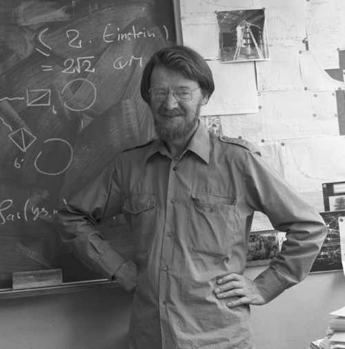

# John Stewart Bell

**Born:** 28 July 1928

**Died / status:** 1 October 1990

**Fields:** Quantum foundations, Particle physics

Sourced photograph or portrait; the image record identifies its creator, provenance, and reuse conditions.

## Biography

A Northern Irish theorist who worked at Harwell and CERN, Bell pursued the foundations of quantum mechanics alongside particle physics. His work transformed conceptual arguments about quantum theory into experimentally testable constraints.

## Major contributions to physics

- Derived Bell inequalities obeyed by local hidden-variable theories.
- Showed that some quantum-entanglement predictions are incompatible with hidden-variable models satisfying local causality.
- Investigated the chiral anomaly with Jackiw.

## Image source and rights

- Source: [Original image record](https://commons.wikimedia.org/wiki/File:John_bell_2_(cropped).png)
- Creator / attribution: CERN
- License or rights statement: [CC BY 4.0](https://creativecommons.org/licenses/by/4.0)
- Local image: [3edefe92035388643afa.png](../portraits/3edefe92035388643afa.png)
- Credit: https://cds.cern.ch/record/1823937

## Sources

- [John Stewart Bell — biographical or institutional source (www.aps.org)](https://www.aps.org/apsnews/2022/10/john-stewart-bell-quantum-theory)
- [John Stewart Bell — biographical or institutional source (mathshistory.st-andrews.ac.uk)](https://mathshistory.st-andrews.ac.uk/Biographies/Bell_John/)
- [John Stewart Bell — reference biography (en.wikipedia.org)](https://en.wikipedia.org/wiki/John_Stewart_Bell)

Record reviewed: 2026-10-26.
