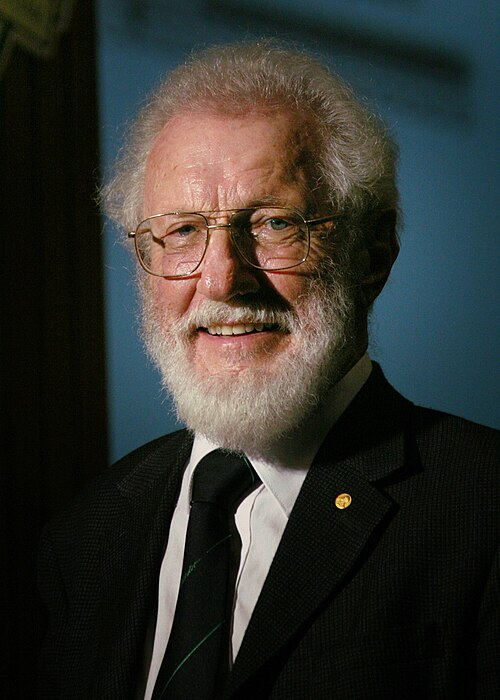

# Herbert Kroemer

**Born:** 25 August 1928

**Died / status:** 8 March 2024

**Fields:** Semiconductor physics, Electronic devices

For the photographer or artist, date and type of image, consult the original image record.

## Biography

Herbert Kroemer was born in Weimar, Germany and conducted research in semiconductor physics and electronic devices. Nobel records list University of California as the affiliation at the time of the award. They proposed and developed heterojunction semiconductor devices. They were awarded the Nobel Prize in Physics in 2000.

## Major contributions to physics

- Proposed and developed heterojunction semiconductor devices
- Established theoretical foundations for high-speed transistors and heterostructure lasers

**Nobel Prize in Physics:** 2000

## Image source and rights

- Source: [Original image record](https://commons.wikimedia.org/wiki/File:Herbert_Kroemer_(cropped).jpg)
- Creator / attribution: Javier Chagoya
- License or rights statement: Public domain
- Local image: [6bafb8ade2511cb4768c.jpg](../portraits/6bafb8ade2511cb4768c.jpg)
- Credit: http://www.nps.edu/pao/photogallery/Details.asp?img=429

## Sources

- [Herbert Kroemer - Facts](https://www.nobelprize.org/prizes/physics/2000/kroemer/facts/)
- [Nobel Prize official laureate API, id 727](https://api.nobelprize.org/2.1/laureate/727)
- [Wikipedia: Herbert Kroemer](https://en.wikipedia.org/wiki/Herbert_Kroemer)

Record reviewed: 2026-10-26.
