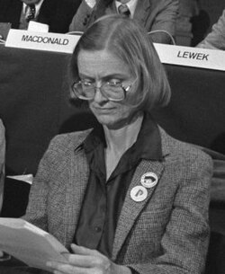

# Vera Kistiakowsky

**Born:** 9 September 1928

**Died / status:** 11 December 2021

**Fields:** Experimental particle physics, Nuclear physics

Sourced photograph or portrait; the image record identifies its creator, provenance, and reuse conditions.

## Biography

An American experimental physicist trained at Berkeley, Kistiakowsky spent much of her career at MIT. She worked on accelerator and particle-detection experiments and promoted women's participation and leadership in physics.

## Major contributions to physics

- Investigated nuclear reactions and elementary-particle scattering.
- Contributed to high-energy detectors and accelerator experiments.
- Performed experimental studies of particle properties and weak interactions.

## Image source and rights

- Source: [Original image record](https://commons.wikimedia.org/wiki/File:Vera_Kistiakowsky_%281981%29.jpg)
- Creator / attribution: Rob Bogaerts for Anefo
- License or rights statement: [CC BY-SA 3.0 nl](https://commons.wikimedia.org/wiki/File:Vera_Kistiakowsky_%281981%29.jpg)
- Local image: [950d2e95662e683fe6d6.jpg](../portraits/950d2e95662e683fe6d6.jpg)
- Credit: Cut from Fotocollectie Anefo. Nationaal Archief, Den Haag, nummertoegang 2.24.01.05, bestanddeelnummer 931-8302.

## Sources

- [Vera Kistiakowsky — reference biography (en.wikipedia.org)](https://en.wikipedia.org/wiki/Vera_Kistiakowsky)

Record reviewed: 2026-10-26.
