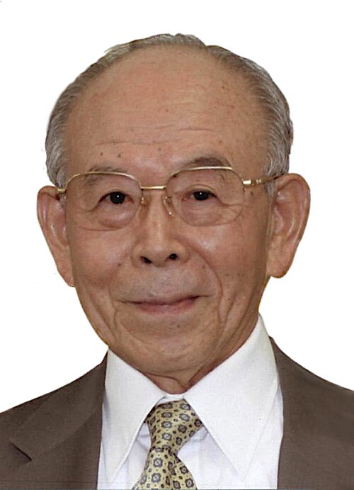

# Isamu Akasaki

**Born:** 30 January 1929

**Died / status:** 1 April 2021

**Fields:** Semiconductor physics, Optoelectronics

For the photographer or artist, date and type of image, consult the original image record.

## Biography

Isamu Akasaki was born in Chiran, Japan and conducted research in semiconductor physics and optoelectronics. Nobel records list Meijo University and Nagoya University as the affiliations at the time of the award. They developed efficient blue light-emitting diodes. They were awarded the Nobel Prize in Physics in 2014.

## Major contributions to physics

- Developed efficient blue light-emitting diodes
- Enabled energy-efficient white lighting and related optoelectronic devices

**Nobel Prize in Physics:** 2014

## Image source and rights

- Source: [Original image record](https://commons.wikimedia.org/wiki/File:Isamu_Akasaki_201111.jpg)
- Creator / attribution: 大臣官房人事課
- License or rights statement: [CC BY 4.0](https://creativecommons.org/licenses/by/4.0)
- Local image: [a59c03097b8f95b5540d.jpg](../portraits/a59c03097b8f95b5540d.jpg)
- Credit: Original credit is retained in the source record.

## Sources

- [Isamu Akasaki - Facts](https://www.nobelprize.org/prizes/physics/2014/akasaki/facts/)
- [Nobel Prize official laureate API, id 906](https://api.nobelprize.org/2.1/laureate/906)
- [Wikipedia: Isamu Akasaki](https://en.wikipedia.org/wiki/Isamu_Akasaki)

Record reviewed: 2026-10-26.
