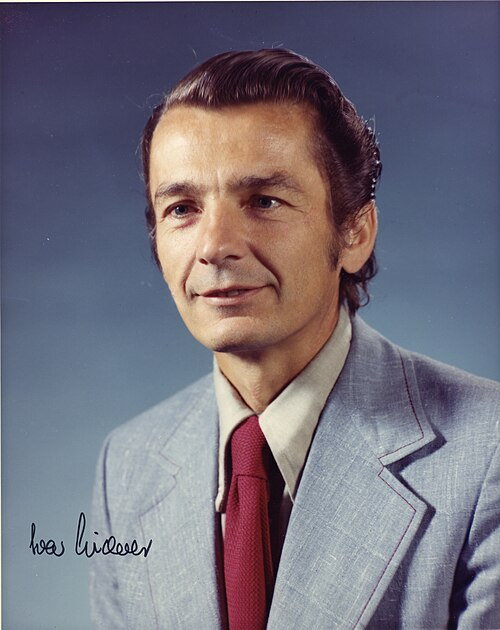

# Ivar Giaever

**Born:** 5 April 1929

**Died / status:** 20 June 2025

**Fields:** Condensed-matter physics, Superconductivity

For the photographer or artist, date and type of image, consult the original image record.

## Biography

Ivar Giaever was born in Bergen, Norway and conducted research in condensed-matter physics and superconductivity. Nobel records list General Electric Company as the affiliation at the time of the award. They used electron tunnelling to investigate superconducting energy gaps. They were awarded the Nobel Prize in Physics in 1973.

## Major contributions to physics

- Used electron tunnelling to investigate superconducting energy gaps
- Provided experimental support for the microscopic theory of superconductivity

**Nobel Prize in Physics:** 1973

## Image source and rights

- Source: [Original image record](https://commons.wikimedia.org/wiki/File:Ivar_Giaever_1973.jpg)
- Creator / attribution: AIP Emilio Segrè Visual Archives, W. F. Meggers Gallery of Nobel Laureates Collection
- License or rights statement: Attribution
- Local image: [ec15fa5e42f8a925ef6c.jpg](../portraits/ec15fa5e42f8a925ef6c.jpg)
- Credit: https://repository.aip.org/ivar-giaever

## Sources

- [Ivar Giaever - Facts](https://www.nobelprize.org/prizes/physics/1973/giaever/facts/)
- [Nobel Prize official laureate API, id 98](https://api.nobelprize.org/2.1/laureate/98)
- [Wikipedia: Ivar Giaever](https://en.wikipedia.org/wiki/Ivar_Giaever)

Record reviewed: 2026-10-26.
