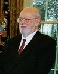

# Paul Lauterbur

**Born:** 6 May 1929

**Died / status:** 27 March 2007

**Fields:** Magnetic resonance imaging, Medical physics

Sourced portrait or photograph; see the image record for provenance and reuse conditions.

## Biography

An American chemist and magnetic-resonance researcher at Stony Brook and Illinois, Lauterbur combined NMR with spatial magnetic-field gradients. His contributions to imaging earned a share of the 2003 Nobel Prize in Physiology or Medicine.

## Major contributions to physics

- Used magnetic-field gradients to encode spatial positions in NMR signals.
- Demonstrated early two-dimensional magnetic-resonance images.
- Developed physical methods in NMR spectroscopy and imaging.

## Image source and rights

- Source: [Original image record](https://commons.wikimedia.org/wiki/File:Paul_Lauterbur_2003_cropped.jpg)
- Creator / attribution: Bush6NobelLaureates.jpg: Tina Hager derivative work: Elinnea (talk)
- License or rights statement: Public domain
- Local image: [fa4f54636f44c64d8265-6bb9966fcc.jpg](../portraits/fa4f54636f44c64d8265-6bb9966fcc.jpg)
- Credit: Bush6NobelLaureates.jpg

## Sources

- [Paul Lauterbur — institutional or reference biography (www.nobelprize.org)](https://www.nobelprize.org/laureate/764)
- [Paul Lauterbur — institutional or reference biography (maglabweb.magnet.fsu.edu)](https://maglabweb.magnet.fsu.edu/magnet-academy/history-of-electricity-magnetism/pioneers/paul-lauterbur/)
- [Paul Lauterbur — institutional or reference biography (en.wikipedia.org)](https://en.wikipedia.org/wiki/Paul_Lauterbur)

Record reviewed: 2026-10-26.
