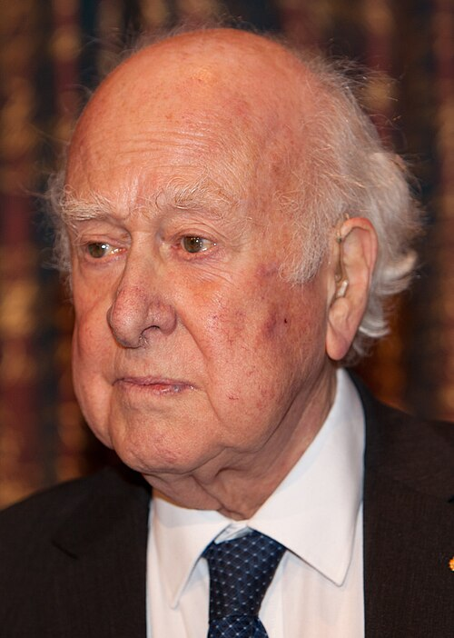

# Peter W. Higgs

**Born:** 29 May 1929

**Died / status:** 8 April 2024

**Fields:** Particle physics, Symmetry breaking

For the photographer or artist, date and type of image, consult the original image record.

## Biography

Peter W. Higgs was born in Newcastle upon Tyne, United Kingdom and conducted research in particle physics and symmetry breaking. Nobel records list University of Edinburgh as the affiliation at the time of the award. They proposed a mechanism in which spontaneous symmetry breaking gives mass to gauge bosons. They were awarded the Nobel Prize in Physics in 2013.

## Major contributions to physics

- Proposed a mechanism in which spontaneous symmetry breaking gives mass to gauge bosons
- Established a central component of the particle-physics Standard Model

**Nobel Prize in Physics:** 2013

## Image source and rights

- Source: [Original image record](https://commons.wikimedia.org/wiki/File:Nobel_Prize_24_2013_%28cropped%29.jpg)
- Creator / attribution: Bengt Nyman
- License or rights statement: [CC BY 2.0](https://commons.wikimedia.org/wiki/File:Nobel_Prize_24_2013_%28cropped%29.jpg)
- Local image: [fc35383db967e9ec1728.jpg](../portraits/fc35383db967e9ec1728.jpg)
- Credit: Flickr: IMG_7469

## Sources

- [Peter Higgs - Facts](https://www.nobelprize.org/prizes/physics/2013/higgs/facts/)
- [Nobel Prize official laureate API, id 888](https://api.nobelprize.org/2.1/laureate/888)
- [Wikipedia: Peter Higgs](https://en.wikipedia.org/wiki/Peter_Higgs)

Record reviewed: 2026-10-26.
