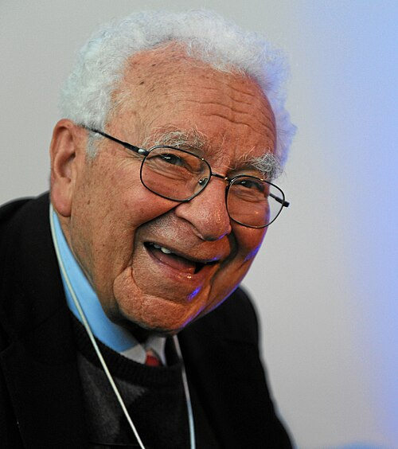

# Murray Gell-Mann

**Born:** 15 September 1929

**Died / status:** 24 May 2019

**Fields:** Particle physics, Quark theory

For the photographer or artist, date and type of image, consult the original image record.

## Biography

Murray Gell-Mann was born in New York, NY, USA and conducted research in particle physics and quark theory. Nobel records list California Institute of Technology (Caltech) as the affiliation at the time of the award. They used symmetry to classify hadrons systematically. They were awarded the Nobel Prize in Physics in 1969.

## Major contributions to physics

- Used symmetry to classify hadrons systematically
- Proposed the quark model and advanced the theory of strong interactions

**Nobel Prize in Physics:** 1969

## Image source and rights

- Source: [Original image record](https://commons.wikimedia.org/wiki/File:Murray_Gell-Mann_-_World_Economic_Forum_Annual_Meeting_2012_%28cropped%29.jpg)
- Creator / attribution: World Economic Forum
- License or rights statement: [CC BY-SA 2.0](https://commons.wikimedia.org/wiki/File:Murray_Gell-Mann_-_World_Economic_Forum_Annual_Meeting_2012_%28cropped%29.jpg)
- Local image: [c73773623029136f68d3.jpg](../portraits/c73773623029136f68d3.jpg)
- Credit: Flickr: Murray Gell-Mann - World Economic Forum Annual Meeting 2012

## Sources

- [Murray Gell-Mann - Facts](https://www.nobelprize.org/prizes/physics/1969/gell-mann/facts/)
- [Nobel Prize official laureate API, id 90](https://api.nobelprize.org/2.1/laureate/90)
- [Wikipedia: Murray Gell-Mann](https://en.wikipedia.org/wiki/Murray_Gell-Mann)

Record reviewed: 2026-10-26.
