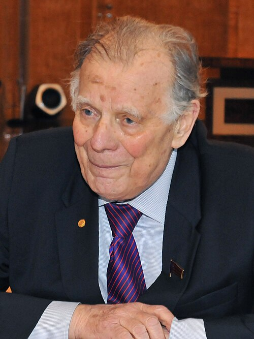

# Zhores I. Alferov

**Born:** 15 March 1930

**Died / status:** 1 March 2019

**Fields:** Semiconductor physics, Optoelectronics

For the photographer or artist, date and type of image, consult the original image record.

## Biography

Zhores I. Alferov was born in Vitebsk, Belorussia, USSR (now Belarus) and conducted research in semiconductor physics and optoelectronics. Nobel records list A.F. Ioffe Physico-Technical Institute as the affiliation at the time of the award. They developed semiconductor heterostructures. They were awarded the Nobel Prize in Physics in 2000.

## Major contributions to physics

- Developed semiconductor heterostructures
- Established important material and device foundations for high-speed electronics and semiconductor lasers

**Nobel Prize in Physics:** 2000

## Image source and rights

- Source: [Original image record](https://commons.wikimedia.org/wiki/File:Zhores_Alferov_April_2016.jpg)
- Creator / attribution: Рустем Кадыров
- License or rights statement: [CC BY 4.0](https://creativecommons.org/licenses/by/4.0)
- Local image: [947e44e008ca78912a46.jpg](../portraits/947e44e008ca78912a46.jpg)
- Credit: https://rais.tatarstan.ru/pressa/photoreports/photoreport/1152247.htm

## Sources

- [Zhores Alferov - Facts](https://www.nobelprize.org/prizes/physics/2000/alferov/facts/)
- [Nobel Prize official laureate API, id 726](https://api.nobelprize.org/2.1/laureate/726)
- [Wikipedia: Zhores Alferov](https://en.wikipedia.org/wiki/Zhores_Alferov)

Record reviewed: 2026-10-26.
