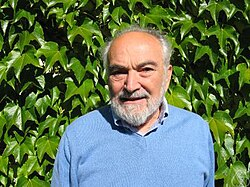

# Joel Lebowitz

**Born:** 10 May 1930

**Died / status:** Living (as of 2026-10-26)

**Fields:** Statistical physics, Nonequilibrium thermodynamics

Sourced portrait or photograph; see the image record for provenance and reuse conditions.

## Biography

A European-born American mathematical physicist at Rutgers, Lebowitz studies rigorous statistical mechanics, equilibrium and nonequilibrium processes, and the origins of macroscopic irreversibility. He also organizes international statistical-physics meetings.

## Major contributions to physics

- Developed rigorous equilibrium and nonequilibrium statistical mechanics.
- Investigated thermodynamic limits, phase transitions, and transport.
- Studied links between reversible microscopic dynamics and irreversible macroscopic behaviour.

## Image source and rights

- Source: [Original image record](https://commons.wikimedia.org/wiki/File:Lebowitz,_Joel_(1930)2.jpeg)
- Creator / attribution: Renate Schmid, Copyright is with MFO
- License or rights statement: [CC BY-SA 2.0 de](https://creativecommons.org/licenses/by-sa/2.0/de/deed.en)
- Local image: [99ca190e532b159d65c6-4ef424823a.jpeg](../portraits/99ca190e532b159d65c6-4ef424823a.jpeg)
- Credit: Mathematisches Institut Oberwolfach (MFO), https://opc.mfo.de/detail?photoID=6577

## Sources

- [Joel Lebowitz — reference biography (en.wikipedia.org)](https://en.wikipedia.org/wiki/Joel_Lebowitz)
- [Joel Lebowitz — institutional or scholarly source (ww2.aip.org)](https://ww2.aip.org/news/joel-l-lebowitz-honored-2021-dannie-heineman-prize-mathematical-physics)

Record reviewed: 2026-10-26.
