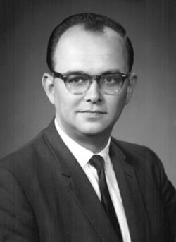

# Hugh Everett III

**Born:** 11 November 1930

**Died / status:** 19 July 1982

**Fields:** Quantum foundations

Sourced photograph or portrait; the image record identifies its creator, provenance, and reuse conditions.

## Biography

An American physicist, Everett completed his Princeton doctorate under Wheeler in 1957. He subsequently worked mainly in operations research and defence analysis, while the account of measurement in his dissertation became influential in quantum foundations.

## Major contributions to physics

- Proposed the universal wavefunction and relative-state formulation.
- Sought to describe measurement using unitary evolution alone.
- Established a foundation for research later called the many-worlds interpretation.

## Image source and rights

- Source: [Original image record](https://en.wikipedia.org/wiki/File:Hugh-Everett.jpg)
- Creator / attribution: See the original image record
- License or rights statement: Copyrighted or republication permission unverified; consult the original record
- Local image: [08e0d590a6b09cffe5f0-530b5d2799.jpg](../portraits/08e0d590a6b09cffe5f0-530b5d2799.jpg)
- Republication: permission for use on a public website has not been verified. Confirm permission with the rightsholder or replace the image before publication.

## Sources

- [Hugh Everett III — reference biography (en.wikipedia.org)](https://en.wikipedia.org/wiki/Hugh_Everett_III)

Record reviewed: 2026-10-26.
