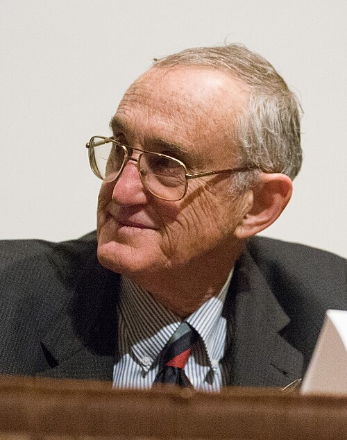

# David M. Lee

**Born:** 20 January 1931

**Died / status:** Living (as of 2026-10-26)

**Fields:** Low-temperature physics, Quantum fluids

For the photographer or artist, date and type of image, consult the original image record.

## Biography

David M. Lee was born in Rye, NY, USA and conducted research in low-temperature physics and quantum fluids. Nobel records list Cornell University as the affiliation at the time of the award. They discovered superfluidity in helium-3. They were awarded the Nobel Prize in Physics in 1996.

## Major contributions to physics

- Discovered superfluidity in helium-3
- Revealed a new system in which paired fermions form a macroscopic quantum state

**Nobel Prize in Physics:** 1996

## Image source and rights

- Source: [Original image record](https://commons.wikimedia.org/wiki/File:Nobel_Laureate_David_Morris_Lee_in_2007.jpg)
- Creator / attribution: Kenneth C. Zirkel
- License or rights statement: [CC BY-SA 3.0](https://commons.wikimedia.org/wiki/File:Nobel_Laureate_David_Morris_Lee_in_2007.jpg)
- Local image: [bb49b42b0525e75f11f6.jpg](../portraits/bb49b42b0525e75f11f6.jpg)
- Credit: Own work

## Sources

- [David M. Lee - Facts](https://www.nobelprize.org/prizes/physics/1996/lee/facts/)
- [Nobel Prize official laureate API, id 149](https://api.nobelprize.org/2.1/laureate/149)
- [Wikipedia: David Lee (physicist)](https://en.wikipedia.org/wiki/David_Lee_%28physicist%29)

Record reviewed: 2026-10-26.
