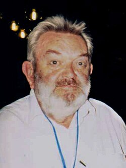

# Martinus J.G. Veltman

**Born:** 27 June 1931

**Died / status:** 4 January 2021

**Fields:** Particle physics, Quantum field theory

For the photographer or artist, date and type of image, consult the original image record.

## Biography

Martinus J.G. Veltman was born in Waalwijk, the Netherlands and conducted research in particle physics and quantum field theory. They established and developed the renormalizable treatment of non-Abelian gauge theories. They were awarded the Nobel Prize in Physics in 1999.

## Major contributions to physics

- Established and developed the renormalizable treatment of non-Abelian gauge theories
- Enabled precise calculations and experimental tests of electroweak theory

**Nobel Prize in Physics:** 1999

## Image source and rights

- Source: [Original image record](https://commons.wikimedia.org/wiki/File:Martinus_Veltman.jpg)
- Creator / attribution: Silin2005
- License or rights statement: Public domain
- Local image: [09248254009e0fe13959.jpg](../portraits/09248254009e0fe13959.jpg)
- Credit: Own work

## Sources

- [Martinus J.G. Veltman - Facts](https://www.nobelprize.org/prizes/physics/1999/veltman/facts/)
- [Nobel Prize official laureate API, id 159](https://api.nobelprize.org/2.1/laureate/159)
- [Wikipedia: Martinus J. G. Veltman](https://en.wikipedia.org/wiki/Martinus_J._G._Veltman)

Record reviewed: 2026-10-26.
