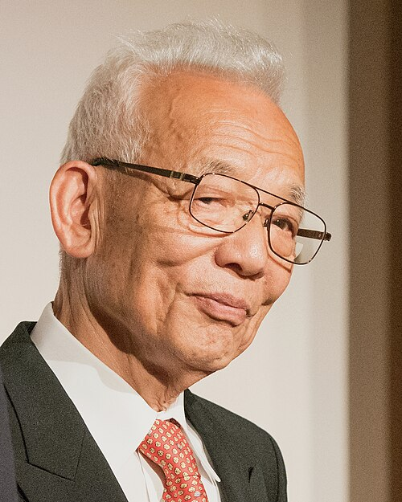

# Syukuro Manabe

**Born:** 21 September 1931

**Died / status:** Living (as of 2026-10-26)

**Fields:** Climate physics, Earth systems

For the photographer or artist, date and type of image, consult the original image record.

## Biography

Syukuro Manabe was born in Shingu, Ehime, Japan and conducted research in climate physics and Earth systems. Nobel records list Princeton University as the affiliation at the time of the award. They developed climate models coupling atmospheric radiation and convection. They were awarded the Nobel Prize in Physics in 2021.

## Major contributions to physics

- Developed climate models coupling atmospheric radiation and convection
- Quantified the temperature response to increasing atmospheric carbon dioxide

**Nobel Prize in Physics:** 2021

## Image source and rights

- Source: [Original image record](https://commons.wikimedia.org/wiki/File:Crafoord_Prize_EM1B0732_(42329290061).jpg)
- Creator / attribution: Bengt Nyman from Vaxholm, Sweden
- License or rights statement: [CC BY 2.0](https://creativecommons.org/licenses/by/2.0)
- Local image: [090acded5e035fe4f015.jpg](../portraits/090acded5e035fe4f015.jpg)
- Credit: Crafoord Prize EM1B0732

## Sources

- [Syukuro Manabe - Facts](https://www.nobelprize.org/prizes/physics/2021/manabe/facts/)
- [Nobel Prize official laureate API, id 999](https://api.nobelprize.org/2.1/laureate/999)
- [Wikipedia: Syukuro Manabe](https://en.wikipedia.org/wiki/Syukuro_Manabe)

Record reviewed: 2026-10-26.
