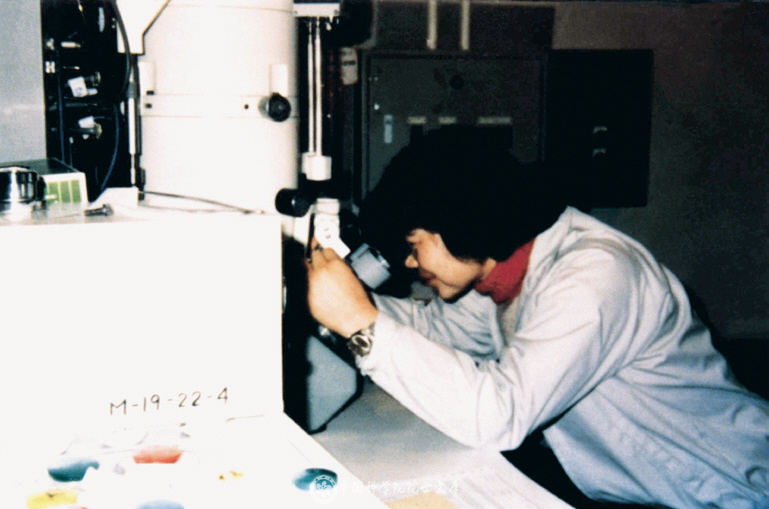

# Li Fanghua

**Born:** 6 January 1932

**Died / status:** 24 January 2020

**Fields:** Condensed-matter physics, Electron microscopy

Li Fanghua working with an electron microscope at Osaka University in 1983; a photograph of the scientist at work rather than a frontal headshot.

## Biography

Born in Hong Kong, Li studied in the Soviet Union and worked at the Institute of Physics of the Chinese Academy of Sciences. She developed high-resolution electron microscopy and methods for extracting reliable crystal-structure information.

## Major contributions to physics

- Developed high-resolution electron microscopy and image analysis.
- Investigated crystal defects and complex-material microstructure.
- Improved reliable structure determination from electron micrographs.

## Image source and rights

- Source: [Original image record](https://casad.cas.cn/zt2022/ysksgs/czy/202605/t20260513_5109507.html)
- Creator / attribution: See the original image record
- License or rights statement: Copyrighted image; no transferable open licence verified. Permission must be confirmed before website publication.
- Local image: [767b4820183493467a83-1e9f6dfe82.png](../portraits/767b4820183493467a83-1e9f6dfe82.png)
- Credit: Chinese Academy of Sciences Academicians Library
- Republication: permission for use on a public website has not been verified. Confirm permission with the rightsholder or replace the image before publication.

## Sources

- [Li Fanghua — institutional or scholarly source (casad.cas.cn)](https://casad.cas.cn/zt2022/ysksgs/czy/202605/t20260513_5109507.html)
- [Li Fanghua — reference biography (en.wikipedia.org)](https://en.wikipedia.org/wiki/Li_Fanghua)

Record reviewed: 2026-10-26.
