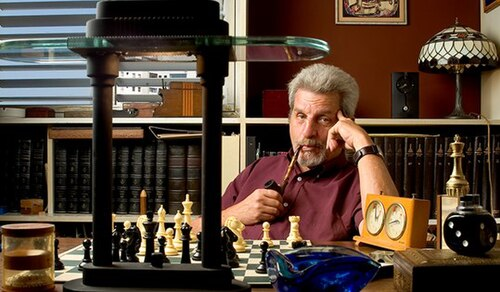

# Yakir Aharonov

**Born:** 28 August 1932

**Died / status:** Living (as of 2026-10-26)

**Fields:** Quantum foundations, Quantum measurement

Sourced photograph or portrait; the image record identifies its creator, provenance, and reuse conditions.

## Biography

An Israeli theorist educated at the Technion and Bristol, Aharonov taught at universities in Israel and the United States. His research addresses quantum phases, measurement, and time symmetry.

## Major contributions to physics

- Predicted the Aharonov–Bohm effect with Bohm, revealing the influence of electromagnetic potentials on quantum phase.
- Co-developed weak measurements and weak values.
- Investigated time-symmetric formulations of quantum theory.

## Image source and rights

- Source: [Original image record](https://commons.wikimedia.org/wiki/File:Yakir_aharonov.jpg)
- Creator / attribution: צלם קובי קלמנוביץ
- License or rights statement: [CC BY-SA 3.0](https://creativecommons.org/licenses/by-sa/3.0)
- Local image: [7c402b1a9c7090d18ef7.jpg](../portraits/7c402b1a9c7090d18ef7.jpg)
- Credit: אתר פרס א.מ.ת

## Sources

- [Yakir Aharonov — reference biography (en.wikipedia.org)](https://en.wikipedia.org/wiki/Yakir_Aharonov)

Record reviewed: 2026-10-26.
