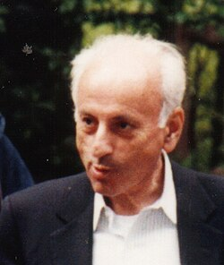

# Melvin Schwartz

**Born:** 2 November 1932

**Died / status:** 28 August 2006

**Fields:** Particle physics, Neutrinos

For the photographer or artist, date and type of image, consult the original image record.

## Biography

Melvin Schwartz was born in New York, NY, USA and conducted research in particle physics and neutrinos. Nobel records list Digital Pathways, Inc. as the affiliation at the time of the award. They used a high-energy neutrino beam to discover the muon neutrino. They were awarded the Nobel Prize in Physics in 1988.

## Major contributions to physics

- Used a high-energy neutrino beam to discover the muon neutrino
- Established that electron and muon neutrinos are distinct

**Nobel Prize in Physics:** 1988

## Image source and rights

- Source: [Original image record](https://commons.wikimedia.org/wiki/File:Melvin_Schwartz.jpg)
- Creator / attribution: AIP Emilio Segrè Visual Archives
- License or rights statement: Attribution
- Local image: [ac39053880009f2ee767.jpg](../portraits/ac39053880009f2ee767.jpg)
- Credit: https://repository.aip.org/celebrating-veltmans-60th

## Sources

- [Melvin Schwartz - Facts](https://www.nobelprize.org/prizes/physics/1988/schwartz/facts/)
- [Nobel Prize official laureate API, id 133](https://api.nobelprize.org/2.1/laureate/133)
- [Wikipedia: Melvin Schwartz](https://en.wikipedia.org/wiki/Melvin_Schwartz)

Record reviewed: 2026-10-26.
