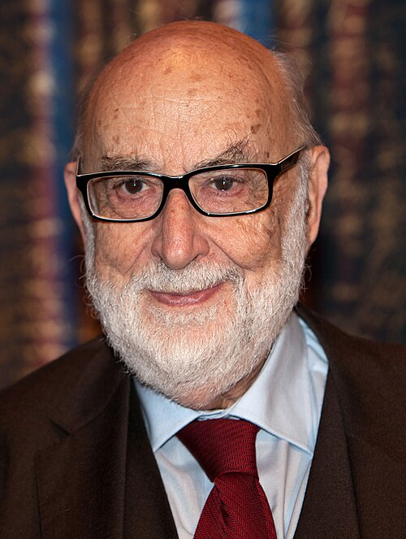

# François Englert

**Born:** 6 November 1932

**Died / status:** 18 June 2026

**Fields:** Particle physics, Symmetry breaking

For the photographer or artist, date and type of image, consult the original image record.

## Biography

François Englert was born in Etterbeek, Belgium and conducted research in particle physics and symmetry breaking. Nobel records list Université Libre de Bruxelles as the affiliation at the time of the award. They proposed a mechanism in which spontaneous symmetry breaking gives mass to gauge bosons. They were awarded the Nobel Prize in Physics in 2013.

## Major contributions to physics

- Proposed a mechanism in which spontaneous symmetry breaking gives mass to gauge bosons
- Established a central component of the particle-physics Standard Model

**Nobel Prize in Physics:** 2013

## Image source and rights

- Source: [Original image record](https://commons.wikimedia.org/wiki/File:Francois_Englert_(3x4_cropped).jpg)
- Creator / attribution: Bengt Nyman from Vaxholm, Sweden
- License or rights statement: [CC BY 2.0](https://creativecommons.org/licenses/by/2.0)
- Local image: [d8022d3406ec1ed996de.jpg](../portraits/d8022d3406ec1ed996de.jpg)
- Credit: IMG_7472

## Sources

- [François Englert - Facts](https://www.nobelprize.org/prizes/physics/2013/englert/facts/)
- [Nobel Prize official laureate API, id 887](https://api.nobelprize.org/2.1/laureate/887)
- [Wikipedia: François Englert](https://en.wikipedia.org/wiki/Fran%C3%A7ois_Englert)

Record reviewed: 2026-10-26.
