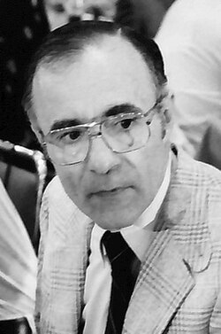

# Arno Allan Penzias

**Born:** 26 April 1933

**Died / status:** 22 January 2024

**Fields:** Radio astronomy, Cosmology

For the photographer or artist, date and type of image, consult the original image record.

## Biography

Arno Allan Penzias was born in Munich, Germany and conducted research in radio astronomy and cosmology. Nobel records list Bell Laboratories as the affiliation at the time of the award. They discovered the cosmic microwave background with Robert Woodrow Wilson. They were awarded the Nobel Prize in Physics in 1978.

## Major contributions to physics

- Discovered the cosmic microwave background with Robert Woodrow Wilson
- Provided crucial observational evidence for hot Big Bang cosmology

**Nobel Prize in Physics:** 1978

## Image source and rights

- Source: [Original image record](https://commons.wikimedia.org/wiki/File:32._Tagung_1982_Physiker;_Beim_Studentenabend_Arno_A._Penzias_-_W134Nr.119142_-_Willy_Pragher_(cropped).jpg)
- Creator / attribution: Willy Pragher
- License or rights statement: [CC BY 3.0 de](https://creativecommons.org/licenses/by/3.0/de/deed.en)
- Local image: [724cae29e8bd3d4911c4.jpg](../portraits/724cae29e8bd3d4911c4.jpg)
- Credit: Landesarchiv Baden-Württemberg, Abt. Staatsarchiv Freiburg, W 134 Nr. 119142

## Sources

- [Arno Penzias - Facts](https://www.nobelprize.org/prizes/physics/1978/penzias/facts/)
- [Nobel Prize official laureate API, id 111](https://api.nobelprize.org/2.1/laureate/111)
- [Wikipedia: Arno Allan Penzias](https://en.wikipedia.org/wiki/Arno_Allan_Penzias)

Record reviewed: 2026-10-26.
