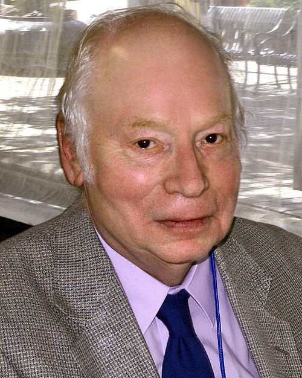

# Steven Weinberg

**Born:** 3 May 1933

**Died / status:** 23 July 2021

**Fields:** Particle physics, Electroweak theory

For the photographer or artist, date and type of image, consult the original image record.

## Biography

Steven Weinberg was born in New York, NY, USA and conducted research in particle physics and electroweak theory. Nobel records list Harvard University as the affiliation at the time of the award. They developed a unified theory of electromagnetic and weak interactions. They were awarded the Nobel Prize in Physics in 1979.

## Major contributions to physics

- Developed a unified theory of electromagnetic and weak interactions
- Predicted and explained phenomena including weak neutral currents

**Nobel Prize in Physics:** 1979

## Image source and rights

- Source: [Original image record](https://commons.wikimedia.org/wiki/File:Steven_Weinberg_2010.jpg)
- Creator / attribution: Larry D. Moore
- License or rights statement: [CC BY 4.0](https://creativecommons.org/licenses/by/4.0)
- Local image: [522af409143155525bc6.jpg](../portraits/522af409143155525bc6.jpg)
- Credit: Own work

## Sources

- [Steven Weinberg - Facts](https://www.nobelprize.org/prizes/physics/1979/weinberg/facts/)
- [Nobel Prize official laureate API, id 115](https://api.nobelprize.org/2.1/laureate/115)
- [Wikipedia: Steven Weinberg](https://en.wikipedia.org/wiki/Steven_Weinberg)

Record reviewed: 2026-10-26.
