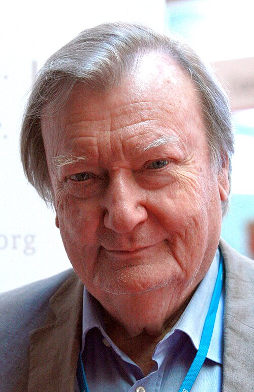

# Carlo Rubbia

**Born:** 31 March 1934

**Died / status:** Living (as of 2026-10-26)

**Fields:** Particle physics, Experimental physics

For the photographer or artist, date and type of image, consult the original image record.

## Biography

Carlo Rubbia was born in Gorizia, Italy and conducted research in particle physics and experimental physics. Nobel records list CERN as the affiliation at the time of the award. They promoted proton-antiproton collider experiments and led the UA1 experiment. They were awarded the Nobel Prize in Physics in 1984.

## Major contributions to physics

- Promoted proton-antiproton collider experiments and led the UA1 experiment
- Made decisive contributions to discovering the W and Z bosons

**Nobel Prize in Physics:** 1984

## Image source and rights

- Source: [Original image record](https://commons.wikimedia.org/wiki/File:Carlo_Rubbia_2012.jpg)
- Creator / attribution: Markus Pössel (user name: Mapos)
- License or rights statement: [CC BY-SA 3.0](https://creativecommons.org/licenses/by-sa/3.0)
- Local image: [a81db51c80c4ec9d7eaf.jpg](../portraits/a81db51c80c4ec9d7eaf.jpg)
- Credit: Own work

## Sources

- [Carlo Rubbia - Facts](https://www.nobelprize.org/prizes/physics/1984/rubbia/facts/)
- [Nobel Prize official laureate API, id 124](https://api.nobelprize.org/2.1/laureate/124)
- [Wikipedia: Carlo Rubbia](https://en.wikipedia.org/wiki/Carlo_Rubbia)

Record reviewed: 2026-10-26.
