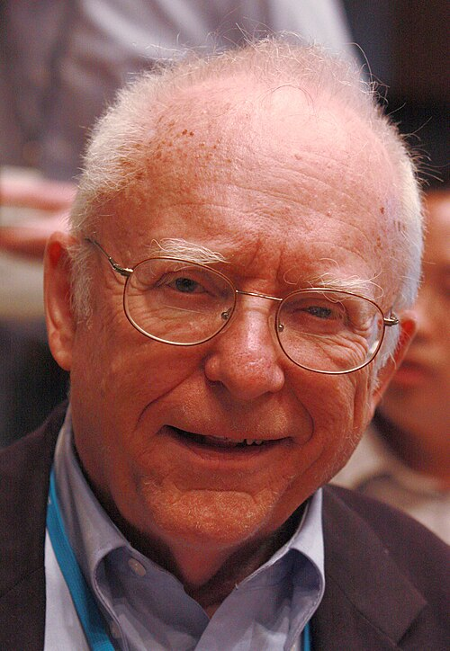

# John L. Hall

**Born:** 21 August 1934

**Died / status:** Living (as of 2026-10-26)

**Fields:** Precision spectroscopy, Laser physics

For the photographer or artist, date and type of image, consult the original image record.

## Biography

John L. Hall was born in Denver, CO, USA and conducted research in precision spectroscopy and laser physics. Nobel records list University of Colorado, JILA and National Institute of Standards and Technology as the affiliations at the time of the award. They developed precision laser spectroscopy and optical-frequency measurement. They were awarded the Nobel Prize in Physics in 2005.

## Major contributions to physics

- Developed precision laser spectroscopy and optical-frequency measurement
- Advanced optical-frequency combs and frequency standards

**Nobel Prize in Physics:** 2005

## Image source and rights

- Source: [Original image record](https://commons.wikimedia.org/wiki/File:John_L._Hall_in_Lindau.jpg)
- Creator / attribution: Markus Pössel (User: Mapos)
- License or rights statement: [CC BY-SA 3.0](https://commons.wikimedia.org/wiki/File:John_L._Hall_in_Lindau.jpg)
- Local image: [0f109e91e33a639f43ad.jpg](../portraits/0f109e91e33a639f43ad.jpg)
- Credit: Own work

## Sources

- [John L. Hall - Facts](https://www.nobelprize.org/prizes/physics/2005/hall/facts/)
- [Nobel Prize official laureate API, id 792](https://api.nobelprize.org/2.1/laureate/792)
- [Wikipedia: John L. Hall](https://en.wikipedia.org/wiki/John_L._Hall)

Record reviewed: 2026-10-26.
