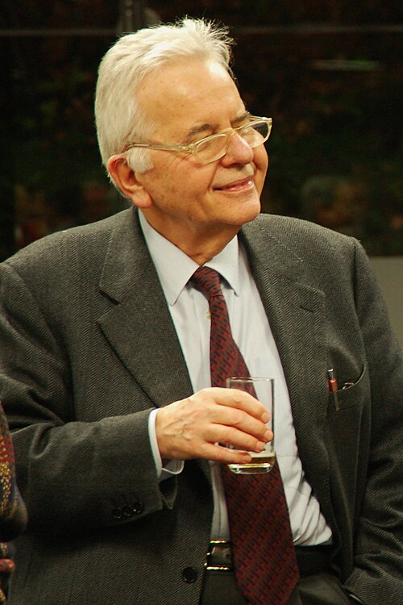

# Nicola Cabibbo

**Born:** 10 April 1935

**Died / status:** 16 August 2010

**Fields:** Particle physics

Sourced photograph or portrait; the image record identifies its creator, provenance, and reuse conditions.

## Biography

An Italian theorist who worked at CERN and Rome and led INFN, Cabibbo studied weak-interaction mixing and helped develop large experimental programmes. His work linked apparently different classes of particle decays.

## Major contributions to physics

- Introduced the Cabibbo angle for weak mixing of down and strange quarks.
- Unified descriptions of strange and nonstrange decays through weak-current universality.
- Established a foundation for three-generation CKM mixing.

## Image source and rights

- Source: [Original image record](https://commons.wikimedia.org/wiki/File:Nicola_Cabibbo.jpg)
- Creator / attribution: Marcella Bona
- License or rights statement: [CC BY-SA 2.0](https://creativecommons.org/licenses/by-sa/2.0)
- Local image: [cd2bd2dcc2f3d7d1bdd9.jpg](../portraits/cd2bd2dcc2f3d7d1bdd9.jpg)
- Credit: nicola cabibbo

## Sources

- [Nicola Cabibbo — reference biography (en.wikipedia.org)](https://en.wikipedia.org/wiki/Nicola_Cabibbo)

Record reviewed: 2026-10-26.
