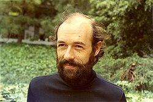

# David Ruelle

**Born:** 20 August 1935

**Died / status:** Living (as of 2026-10-26)

**Fields:** Statistical physics, Complex systems

Sourced portrait or photograph; see the image record for provenance and reuse conditions.

## Biography

A Belgian-born mathematical physicist at IHES, Ruelle connects dynamical systems with rigorous statistical mechanics. His research addresses turbulence, chaos, and nonequilibrium systems.

## Major contributions to physics

- Developed a strange-attractor route to turbulence with Takens.
- Advanced thermodynamic formalism in statistical mechanics.
- Investigated SRB measures for chaotic dissipative systems.

## Image source and rights

- Source: [Original image record](https://commons.wikimedia.org/wiki/File:Ruelle,_David_(1935).jpeg)
- Creator / attribution: George Bergman
- License or rights statement: [GFDL 1.2](http://www.gnu.org/licenses/old-licenses/fdl-1.2.html)
- Local image: [d2d1f904da26c6703e3b-6b7d9f21aa.jpeg](../portraits/d2d1f904da26c6703e3b-6b7d9f21aa.jpeg)
- Credit: Mathematisches Institut Oberwolfach (MFO), https://opc.mfo.de/detail?photoID=5890

## Sources

- [David Ruelle — reference biography (en.wikipedia.org)](https://en.wikipedia.org/wiki/David_Ruelle)
- [David Ruelle — institutional or scholarly source (www.ihes.fr)](http://www.ihes.fr/~ruelle/CVAnglais)

Record reviewed: 2026-10-26.
