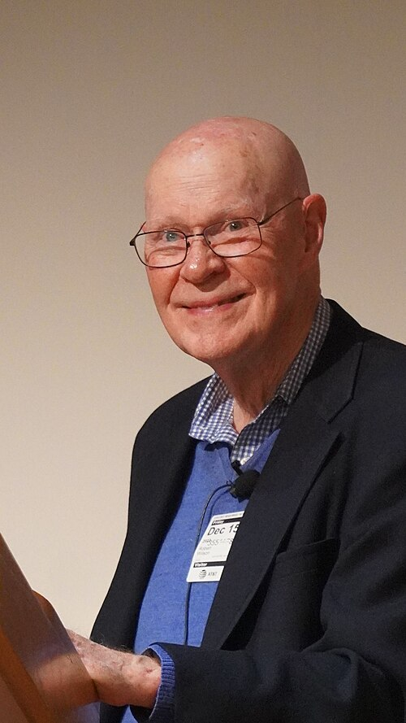

# Robert Woodrow Wilson

**Born:** 10 January 1936

**Died / status:** Living (as of 2026-10-26)

**Fields:** Radio astronomy, Cosmology

For the photographer or artist, date and type of image, consult the original image record.

## Biography

Robert Woodrow Wilson was born in Houston, TX, USA and conducted research in radio astronomy and cosmology. Nobel records list Bell Laboratories as the affiliation at the time of the award. They discovered the nearly isotropic cosmic microwave background with Arno Penzias. They were awarded the Nobel Prize in Physics in 1978.

## Major contributions to physics

- Discovered the nearly isotropic cosmic microwave background with Arno Penzias
- Established a major observational probe of the early universe through microwave-receiver experiments

**Nobel Prize in Physics:** 1978

## Image source and rights

- Source: [Original image record](https://commons.wikimedia.org/wiki/File:Robert_W._Wilson.jpg)
- Creator / attribution: Samtxts
- License or rights statement: [CC BY-SA 4.0](https://commons.wikimedia.org/wiki/File:Robert_W._Wilson.jpg)
- Local image: [130d53214cb08116da75.jpg](../portraits/130d53214cb08116da75.jpg)
- Credit: Own work

## Sources

- [Robert Woodrow Wilson - Facts](https://www.nobelprize.org/prizes/physics/1978/wilson/facts/)
- [Nobel Prize official laureate API, id 112](https://api.nobelprize.org/2.1/laureate/112)
- [Wikipedia: Robert Woodrow Wilson](https://en.wikipedia.org/wiki/Robert_Woodrow_Wilson)

Record reviewed: 2026-10-26.
