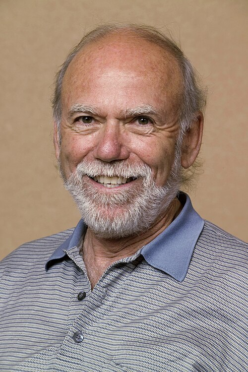

# Barry C. Barish

**Born:** 27 January 1936

**Died / status:** Living (as of 2026-10-26)

**Fields:** Gravitational waves, Experimental physics, Relativity

For the photographer or artist, date and type of image, consult the original image record.

## Biography

Barry C. Barish was born in Omaha, NE, USA and conducted research in gravitational waves, experimental physics and relativity. Nobel records list LIGO/VIRGO Collaboration and California Institute of Technology (Caltech) as the affiliations at the time of the award. They made decisive contributions to the LIGO detector and the first direct observation of gravitational waves. They were awarded the Nobel Prize in Physics in 2017.

## Major contributions to physics

- Made decisive contributions to the LIGO detector and the first direct observation of gravitational waves
- Opened gravitational-wave astronomy through precision interferometry

**Nobel Prize in Physics:** 2017

## Image source and rights

- Source: [Original image record](https://commons.wikimedia.org/wiki/File:05-0367-92D.hr.jpg)
- Creator / attribution: R. Hahn
- License or rights statement: Public domain
- Local image: [a609104bb496704dc72a.jpg](../portraits/a609104bb496704dc72a.jpg)
- Credit: http://vms-db-srv.fnal.gov/fmi/xsl/VMS_Site_2/000Return/photography/r_onlineimages.xsl?OnlineImage=yes&-sortfield.2=MRLinkText&-sortorder.2=ascend&Category=&Category.op=cn&Caption=&Caption.op=cn&Frames%3A%3ANames+of+People+Pictured=&Frames%3A%3ANames+of+People+Pictured.op=cn&Frames%3A%3ADate+of+Photo=&Frames%3A%3AShort+Description=&ImageNumber=05-0367-92D&ImageNumber.op=cn&KeyImage=&-max=10&-sortfield.1=Date+of+Photo&-sortorder.1=descend&-find=Search

## Sources

- [Barry C. Barish - Facts](https://www.nobelprize.org/prizes/physics/2017/barish/facts/)
- [Nobel Prize official laureate API, id 942](https://api.nobelprize.org/2.1/laureate/942)
- [Wikipedia: Barry Barish](https://en.wikipedia.org/wiki/Barry_Barish)

Record reviewed: 2026-10-26.
