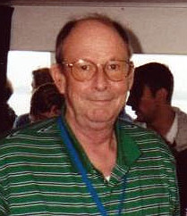

# Robert C. Richardson

**Born:** 26 June 1937

**Died / status:** 19 February 2013

**Fields:** Low-temperature physics, Quantum fluids

For the photographer or artist, date and type of image, consult the original image record.

## Biography

Robert C. Richardson was born in Washington, D.C., USA and conducted research in low-temperature physics and quantum fluids. Nobel records list Cornell University as the affiliation at the time of the award. They discovered superfluidity in helium-3. They were awarded the Nobel Prize in Physics in 1996.

## Major contributions to physics

- Discovered superfluidity in helium-3
- Revealed a new system in which paired fermions form a macroscopic quantum state

**Nobel Prize in Physics:** 1996

## Image source and rights

- Source: [Original image record](https://commons.wikimedia.org/wiki/File:Robert_Coleman_Richardson.jpg)
- Creator / attribution: Silin2005
- License or rights statement: Public domain
- Local image: [06953d3c999a0457f6cc.jpg](../portraits/06953d3c999a0457f6cc.jpg)
- Credit: Own work

## Sources

- [Robert C. Richardson - Facts](https://www.nobelprize.org/prizes/physics/1996/richardson/facts/)
- [Nobel Prize official laureate API, id 151](https://api.nobelprize.org/2.1/laureate/151)
- [Wikipedia: Robert Coleman Richardson](https://en.wikipedia.org/wiki/Robert_Coleman_Richardson)

Record reviewed: 2026-10-26.
