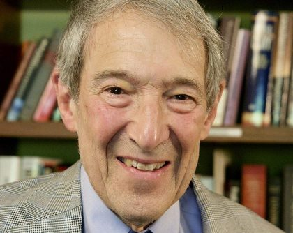

# Daniel Z. Freedman

**Born:** 1939

**Died / status:** Living (as of 2026-10-26)

**Fields:** Supergravity, Quantum field theory

Sourced portrait or photograph; see the image record for provenance and reuse conditions.

## Biography

An American theorist who worked at Stony Brook and MIT, Freedman combined local supersymmetry with gravitation in collaboration with Ferrara and van Nieuwenhuizen, helping establish supergravity.

## Major contributions to physics

- Constructed supergravity with Ferrara and van Nieuwenhuizen.
- Investigated supersymmetric field theory and quantum gravity.
- Developed field-theoretic and gravitational methods relevant to holography.

## Historical and source notes

- The sources reviewed establish the birth year; an unverified month and day have not been added.

## Image source and rights

- Source: [Original image record](https://physics.mit.edu/faculty/daniel-freedman/)
- Creator / attribution: See the original image record
- License or rights statement: Copyrighted image; no transferable open licence verified. Permission must be confirmed before website publication.
- Local image: [1f2338207b04679873c5-acc2462a4f.jpg](../portraits/1f2338207b04679873c5-acc2462a4f.jpg)
- Credit: MIT Department of Physics faculty portrait
- Republication: permission for use on a public website has not been verified. Confirm permission with the rightsholder or replace the image before publication.

## Sources

- [Daniel Z. Freedman — reference biography (en.wikipedia.org)](https://en.wikipedia.org/wiki/Daniel_Z._Freedman)
- [Daniel Z. Freedman — institutional or scholarly source (www.ictp.it)](https://www.ictp.it/prize/dirac-medal)

Record reviewed: 2026-10-26.
