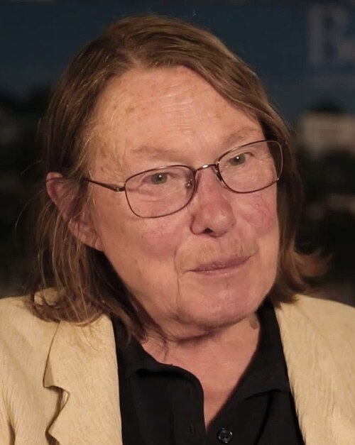

# Mary K. Gaillard

**Born:** 1 April 1939

**Died / status:** 23 May 2025

**Fields:** Particle physics

Sourced photograph or portrait; the image record identifies its creator, provenance, and reuse conditions.

## Biography

An American theorist who worked at CERN and became the first woman to hold a tenured position in Berkeley's physics department, Gaillard connected precision calculations with experimental tests of the standard model.

## Major contributions to physics

- Estimated the charm-quark mass with Benjamin Lee.
- Investigated three-jet events as evidence for gluons with Ellis and Ross.
- Contributed to theoretical studies of Higgs-boson production and detection.

## Image source and rights

- Source: [Original image record](https://commons.wikimedia.org/wiki/File:Mary_Gaillard,_2015.jpg)
- Creator / attribution: UC Berkeley, Roxanne Makasdjian, Phil Ebiner
- License or rights statement: [CC BY 3.0](https://creativecommons.org/licenses/by/3.0)
- Local image: [957d4891070818184c9d.jpg](../portraits/957d4891070818184c9d.jpg)
- Credit: Mary Gaillard, Berkeley's Feminist Physicist (frame grab, 0:05)

## Sources

- [Mary K. Gaillard — biographical or institutional source (news.berkeley.edu)](https://news.berkeley.edu/2025/07/08/pioneering-theoretical-physicist-mary-k-gaillard-has-died-at-86/)
- [Mary K. Gaillard — reference biography (en.wikipedia.org)](https://en.wikipedia.org/wiki/Mary_K._Gaillard)

Record reviewed: 2026-10-26.
