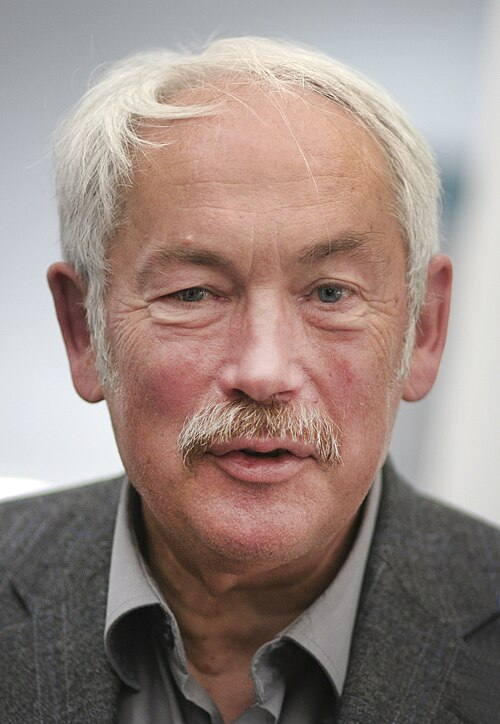

# Peter Grünberg

**Born:** 18 May 1939

**Died / status:** 7 April 2018

**Fields:** Condensed-matter physics, Spintronics

For the photographer or artist, date and type of image, consult the original image record.

## Biography

Peter Grünberg was born in Plzen, Czechoslovakia (now Czech Republic) and conducted research in condensed-matter physics and spintronics. Nobel records list Forschungszentrum Jülich as the affiliation at the time of the award. They independently discovered giant magnetoresistance. They were awarded the Nobel Prize in Physics in 2007.

## Major contributions to physics

- Independently discovered giant magnetoresistance
- Revealed the influence of electron spin on electrical transport in magnetic multilayers

**Nobel Prize in Physics:** 2007

## Historical and source notes

- He died on 7 April 2018, according to Forschungszentrum Jülich's biographical record. The centre announced the death on 9 April; the announcement date should not be substituted for the date of death.

## Image source and rights

- Source: [Original image record](https://commons.wikimedia.org/wiki/File:Peter_Gruenberg_01.jpg)
- Creator / attribution: Kuebi = Armin Kübelbeck
- License or rights statement: [CC BY-SA 3.0](https://commons.wikimedia.org/wiki/File:Peter_Gruenberg_01.jpg)
- Local image: [ea8b1efdff884beb31bd.jpg](../portraits/ea8b1efdff884beb31bd.jpg)
- Credit: Own work

## Sources

- [Peter Grünberg - Facts](https://www.nobelprize.org/prizes/physics/2007/grunberg/facts/)
- [Nobel Prize official laureate API, id 815](https://api.nobelprize.org/2.1/laureate/815)
- [Wikipedia: Peter Grünberg](https://en.wikipedia.org/wiki/Peter_Gr%C3%BCnberg)
- [Forschungszentrum Jülich: Peter A. Grünberg curriculum vitae](https://www.fz-juelich.de/de/forschung/gmr/lebenslauf-peter-a-gruenberg)
- [Forschungszentrum Jülich: Nobelpreisträger Peter Grünberg gestorben](https://www.fz-juelich.de/de/pgi/pgi-9/aktuelles/nobelpreistraeger-peter-gruenberg-gestorben)

Record reviewed: 2026-10-26.
