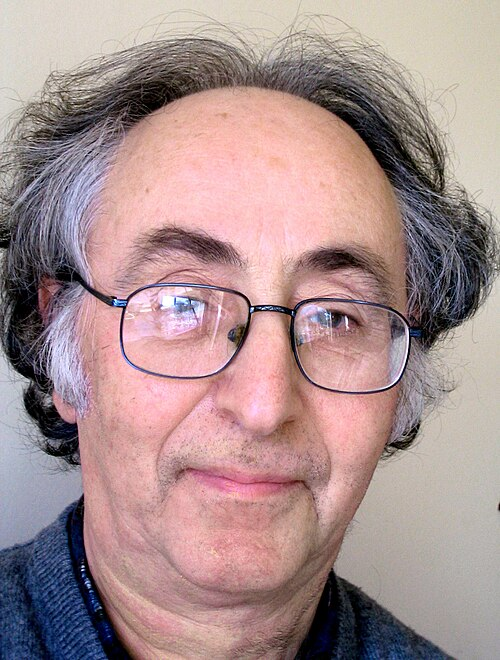

# Brian David Josephson

**Born:** 4 January 1940

**Died / status:** Living (as of 2026-10-26)

**Fields:** Condensed-matter physics, Superconductivity

For the photographer or artist, date and type of image, consult the original image record.

## Biography

Brian David Josephson was born in Cardiff, United Kingdom and conducted research in condensed-matter physics and superconductivity. Nobel records list University of Cambridge as the affiliation at the time of the award. They predicted the tunnelling of Cooper pairs between superconductors. They were awarded the Nobel Prize in Physics in 1973.

## Major contributions to physics

- Predicted the tunnelling of Cooper pairs between superconductors
- Established the theoretical basis of the Josephson effect

**Nobel Prize in Physics:** 1973

## Image source and rights

- Source: [Original image record](https://commons.wikimedia.org/wiki/File:Brian_Josephson,_March_2004.jpg)
- Creator / attribution: Brian Josephson
- License or rights statement: [CC BY 3.0](https://creativecommons.org/licenses/by/3.0)
- Local image: [72bfefdd83e028afb78b.jpg](../portraits/72bfefdd83e028afb78b.jpg)
- Credit: Released by Brian Josephson by email; taken from his homepage

## Sources

- [Brian D. Josephson - Facts](https://www.nobelprize.org/prizes/physics/1973/josephson/facts/)
- [Nobel Prize official laureate API, id 99](https://api.nobelprize.org/2.1/laureate/99)
- [Wikipedia: Brian David Josephson](https://en.wikipedia.org/wiki/Brian_David_Josephson)

Record reviewed: 2026-10-26.
