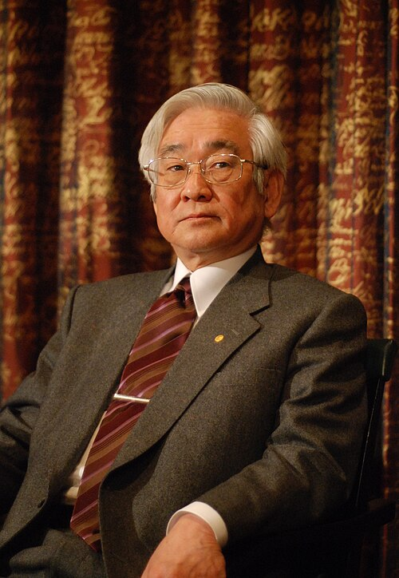

# Toshihide Maskawa

**Born:** 7 February 1940

**Died / status:** 23 July 2021

**Fields:** Particle physics, Quark mixing

For the photographer or artist, date and type of image, consult the original image record.

## Biography

Toshihide Maskawa was born in Nagoya, Japan and conducted research in particle physics and quark mixing. Nobel records list Kyoto Sangyo University and Yukawa Institute for Theoretical Physics (YITP), Kyoto University as the affiliations at the time of the award. They developed a three-generation quark-mixing theory with Makoto Kobayashi. They were awarded the Nobel Prize in Physics in 2008.

## Major contributions to physics

- Developed a three-generation quark-mixing theory with Makoto Kobayashi
- Showed how a complex phase in the quark-mixing matrix can produce CP violation

**Nobel Prize in Physics:** 2008

## Image source and rights

- Source: [Original image record](https://commons.wikimedia.org/wiki/File:Toshihide_Masukawa-press_conference_Dec_07th,_2008-2.jpg)
- Creator / attribution: Prolineserver (talk)
- License or rights statement: [GFDL 1.2](http://www.gnu.org/licenses/old-licenses/fdl-1.2.html)
- Local image: [d369bfc88aedf16e64fb.jpg](../portraits/d369bfc88aedf16e64fb.jpg)
- Credit: Own work

## Sources

- [Toshihide Maskawa - Facts](https://www.nobelprize.org/prizes/physics/2008/maskawa/facts/)
- [Nobel Prize official laureate API, id 828](https://api.nobelprize.org/2.1/laureate/828)
- [Wikipedia: Toshihide Maskawa](https://en.wikipedia.org/wiki/Toshihide_Maskawa)

Record reviewed: 2026-10-26.
