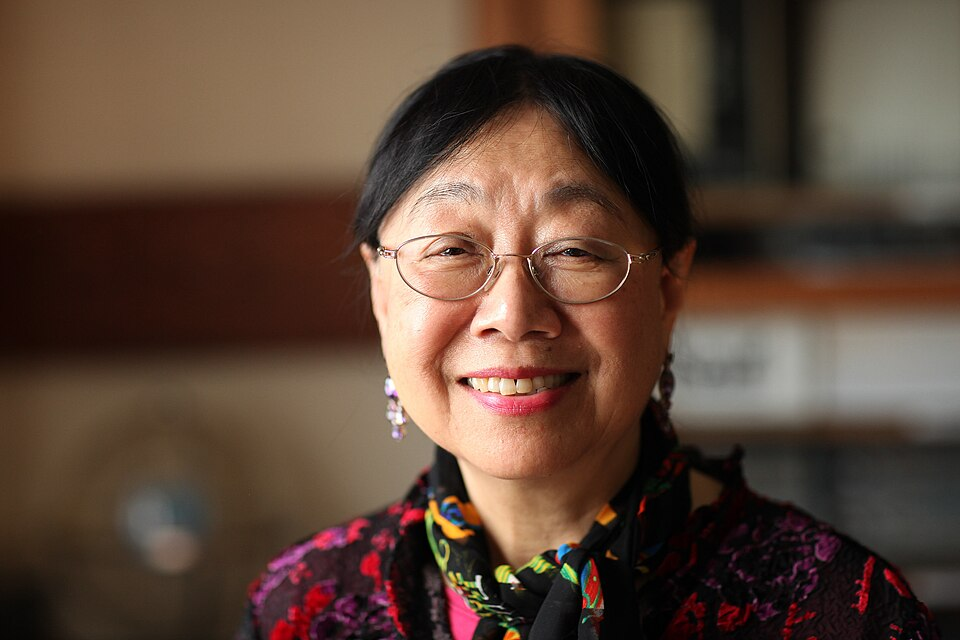

# Sau Lan Wu

**Born:** 11 May 1940

**Died / status:** Living (as of 2026-10-26)

**Fields:** Experimental particle physics

Sourced photograph or portrait; the image record identifies its creator, provenance, and reuse conditions.

## Biography

Born in Hong Kong, Wu obtained her doctorate at Harvard and taught at Wisconsin–Madison. She participated in several generations of collider experiments investigating elementary particles and strong and weak interactions.

## Major contributions to physics

- Participated in the experimental discovery of the J/psi particle.
- Contributed to TASSO three-jet evidence for the gluon.
- Led teams participating in ATLAS and the Higgs-boson discovery.

## Image source and rights

- Source: [Original image record](https://commons.wikimedia.org/wiki/File:Physicist_Sau_Lan_Wu.jpg)
- Creator / attribution: DASwartz
- License or rights statement: [CC BY-SA 4.0](https://commons.wikimedia.org/wiki/File:Physicist_Sau_Lan_Wu.jpg)
- Local image: [bc6a216eb51d73549496.jpg](../portraits/bc6a216eb51d73549496.jpg)
- Credit: Own work

## Sources

- [Sau Lan Wu — reference biography (en.wikipedia.org)](https://en.wikipedia.org/wiki/Sau_Lan_Wu)

Record reviewed: 2026-10-26.
