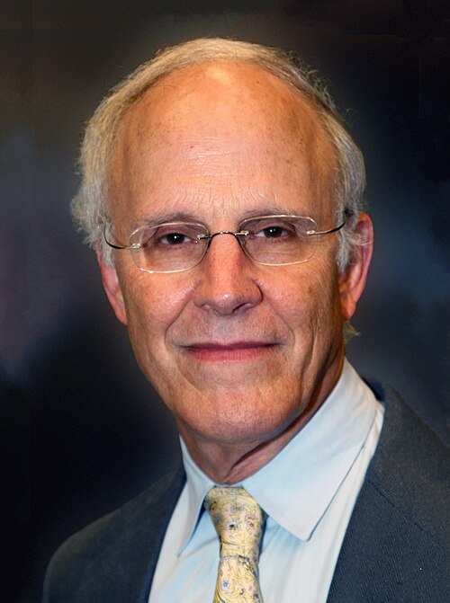

# David J. Gross

**Born:** 19 February 1941

**Died / status:** Living (as of 2026-10-26)

**Fields:** Particle physics, Quantum chromodynamics

For the photographer or artist, date and type of image, consult the original image record.

## Biography

David J. Gross was born in Washington, D.C., USA and conducted research in particle physics and quantum chromodynamics. Nobel records list University of California, Kavli Institute for Theoretical Physics as the affiliation at the time of the award. They discovered asymptotic freedom in non-Abelian gauge theory. They were awarded the Nobel Prize in Physics in 2004.

## Major contributions to physics

- Discovered asymptotic freedom in non-Abelian gauge theory
- Explained why quark interactions become weaker at short distances and high energies

**Nobel Prize in Physics:** 2004

## Image source and rights

- Source: [Original image record](https://commons.wikimedia.org/wiki/File:David_Gross_LANL.jpg)
- Creator / attribution: LANL
- License or rights statement: Attribution
- Local image: [da17bee88ecd2fef0e52.jpg](../portraits/da17bee88ecd2fef0e52.jpg)
- Credit: http://www.lanl.gov/news/newsbulletin/2007/10/11731.shtml

## Sources

- [David J. Gross - Facts](https://www.nobelprize.org/prizes/physics/2004/gross/facts/)
- [Nobel Prize official laureate API, id 776](https://api.nobelprize.org/2.1/laureate/776)
- [Wikipedia: David Gross](https://en.wikipedia.org/wiki/David_Gross)

Record reviewed: 2026-10-26.
