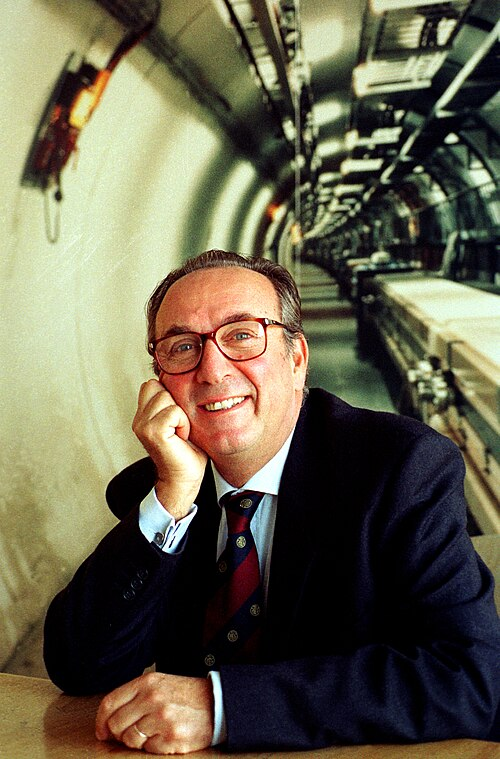

# Luciano Maiani

**Born:** 16 July 1941

**Died / status:** Living (as of 2026-10-26)

**Fields:** Particle physics

Sourced photograph or portrait; the image record identifies its creator, provenance, and reuse conditions.

## Biography

Born in Rome, Maiani is a theoretical physicist associated with the University of Rome and the leadership of INFN and CERN. His weak-interaction research accompanied an important role in European large-scale particle physics.

## Major contributions to physics

- Proposed the GIM mechanism with Glashow and Iliopoulos.
- Investigated quark flavour, CP violation, and hadron structure.
- Advanced standard-model research and major high-energy experiments.

## Historical and source notes

- The birth date is 16 July 1941 according to CERN’s official curriculum vitae. Some encyclopedia infoboxes incorrectly give 16 June.

## Image source and rights

- Source: [Original image record](https://commons.wikimedia.org/wiki/File:Luciano_Maiani_1996.jpg)
- Creator / attribution: Laurent Guiraud
- License or rights statement: [CC BY-SA 3.0](https://creativecommons.org/licenses/by-sa/3.0)
- Local image: [3db51c70368e05c08ca2.jpg](../portraits/3db51c70368e05c08ca2.jpg)
- Credit: CERN Document Server

## Sources

- [Luciano Maiani — biographical or institutional source (archives.web.cern.ch)](https://archives.web.cern.ch/CERN_archive/guide/management/directors_general/isamaiani/)
- [Luciano Maiani — biographical or institutional source (home.cern)](https://home.cern/fr/le-professeur-luciano-maiani-sera-le-prochain-directeur-general-du-cern/)
- [Luciano Maiani — reference biography (en.wikipedia.org)](https://en.wikipedia.org/wiki/Luciano_Maiani)

Record reviewed: 2026-10-26.
