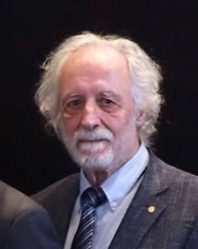

# Pierre Agostini

**Born:** 23 July 1941

**Died / status:** Living (as of 2026-10-26)

**Fields:** Attosecond physics, Ultrafast optics

For the photographer or artist, date and type of image, consult the original image record.

## Biography

Pierre Agostini was born in Tunis, French protectorate of Tunisia (now Tunisia) and conducted research in attosecond physics and ultrafast optics. Nobel records list The Ohio State University as the affiliation at the time of the award. They developed experimental methods for producing attosecond light pulses. They were awarded the Nobel Prize in Physics in 2023.

## Major contributions to physics

- Developed experimental methods for producing attosecond light pulses
- Made it possible to investigate ultrafast electron dynamics in matter

**Nobel Prize in Physics:** 2023

## Image source and rights

- Source: [Original image record](https://commons.wikimedia.org/wiki/File:US_Embassy_Sweden_2023_Nobel_Reception_(53397591873)_(cropped).jpg)
- Creator / attribution: US Embassy Sweden
- License or rights statement: [CC BY 2.0](https://creativecommons.org/licenses/by/2.0)
- Local image: [3a23cc0e48aaa993b7d0.jpg](../portraits/3a23cc0e48aaa993b7d0.jpg)
- Credit: Image 3

## Sources

- [Pierre Agostini - Facts](https://www.nobelprize.org/prizes/physics/2023/agostini/facts/)
- [Nobel Prize official laureate API, id 1026](https://api.nobelprize.org/2.1/laureate/1026)
- [Wikipedia: Pierre Agostini](https://en.wikipedia.org/wiki/Pierre_Agostini)

Record reviewed: 2026-10-26.
