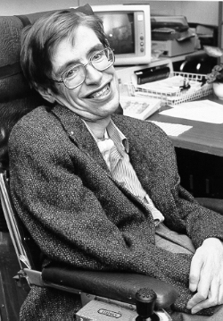

# Stephen Hawking

**Born:** 8 January 1942

**Died / status:** 14 March 2018

**Fields:** Cosmology, Black-hole physics

Sourced photograph or portrait; the image record identifies its creator, provenance, and reuse conditions.

## Biography

A British theorist at Cambridge and former Lucasian Professor, Hawking continued research and writing during decades of motor-neurone disease. He connected general relativity, quantum theory, and cosmology.

## Major contributions to physics

- Established singularity theorems with Penrose.
- Predicted that black holes have a temperature and emit Hawking radiation.
- Proposed the no-boundary cosmological wavefunction with Hartle.

## Image source and rights

- Source: [Original image record](https://commons.wikimedia.org/wiki/File:Stephen_Hawking.StarChild.jpg)
- Creator / attribution: NASA
- License or rights statement: Public domain
- Local image: [228f2fee4e63012b101e.jpg](../portraits/228f2fee4e63012b101e.jpg)
- Credit: Original. Source (StarChild Learning Center). Archived directory listing at the Wayback Machine.

## Sources

- [Stephen Hawking — reference biography (en.wikipedia.org)](https://en.wikipedia.org/wiki/Stephen_Hawking)

Record reviewed: 2026-10-26.
