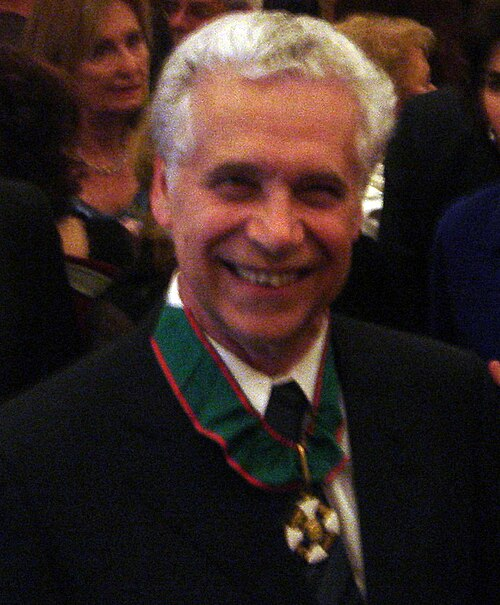

# Gabriele Veneziano

**Born:** 7 September 1942

**Died / status:** Living (as of 2026-10-26)

**Fields:** String theory, Particle physics

Sourced portrait or photograph; see the image record for provenance and reuse conditions.

## Biography

An Italian theorist at CERN and the Collège de France, Veneziano proposed a hadronic-scattering amplitude that became a starting point of string theory. His later work addresses strong interactions and cosmology.

## Major contributions to physics

- Introduced the Veneziano amplitude.
- Advanced large-N and nonperturbative approaches to strong interactions.
- Investigated connections between strings and the early universe.

## Image source and rights

- Source: [Original image record](https://commons.wikimedia.org/wiki/File:GabrieleVeneziano.jpg)
- Creator / attribution: The original uploader was Betsythedevine at English Wikipedia.
- License or rights statement: [CC BY-SA 2.5](https://creativecommons.org/licenses/by-sa/2.5)
- Local image: [55bec79fd9d82d8198b6-ae37a65b57.jpg](../portraits/55bec79fd9d82d8198b6-ae37a65b57.jpg)
- Credit: Taken by Betsythedevine

## Sources

- [Gabriele Veneziano — reference biography (en.wikipedia.org)](https://en.wikipedia.org/wiki/Gabriele_Veneziano)
- [Gabriele Veneziano — institutional or scholarly source (www.ictp.it)](https://www.ictp.it/prize/dirac-medal)

Record reviewed: 2026-10-26.
