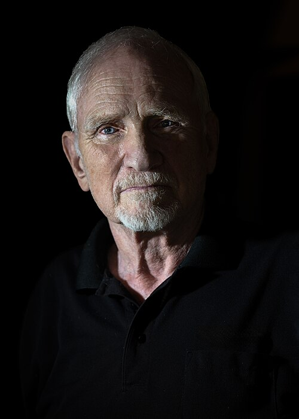

# John F. Clauser

**Born:** 1 December 1942

**Died / status:** Living (as of 2026-10-26)

**Fields:** Quantum foundations, Quantum information

For the photographer or artist, date and type of image, consult the original image record.

## Biography

John F. Clauser was born in Pasadena, CA, USA and conducted research in quantum foundations and quantum information. Nobel records list J.F. Clauser & Assoc. as the affiliation at the time of the award. They performed entangled-photon experiments and tested Bell inequalities. They were awarded the Nobel Prize in Physics in 2022.

## Major contributions to physics

- Performed entangled-photon experiments and tested Bell inequalities
- Established important experimental foundations for quantum information science

**Nobel Prize in Physics:** 2022

## Image source and rights

- Source: [Original image record](https://commons.wikimedia.org/wiki/File:John_Clauser_Updated_2024.jpg)
- Creator / attribution: Christopher Michel (1967–)
- License or rights statement: [CC BY 4.0](https://commons.wikimedia.org/wiki/File:John_Clauser_Updated_2024.jpg)
- Local image: [fb54b68330893803fdc0.jpg](../portraits/fb54b68330893803fdc0.jpg)
- Credit: Own work

## Sources

- [John Clauser - Facts](https://www.nobelprize.org/prizes/physics/2022/clauser/facts/)
- [Nobel Prize official laureate API, id 1013](https://api.nobelprize.org/2.1/laureate/1013)
- [Wikipedia: John Clauser](https://en.wikipedia.org/wiki/John_Clauser)

Record reviewed: 2026-10-26.
