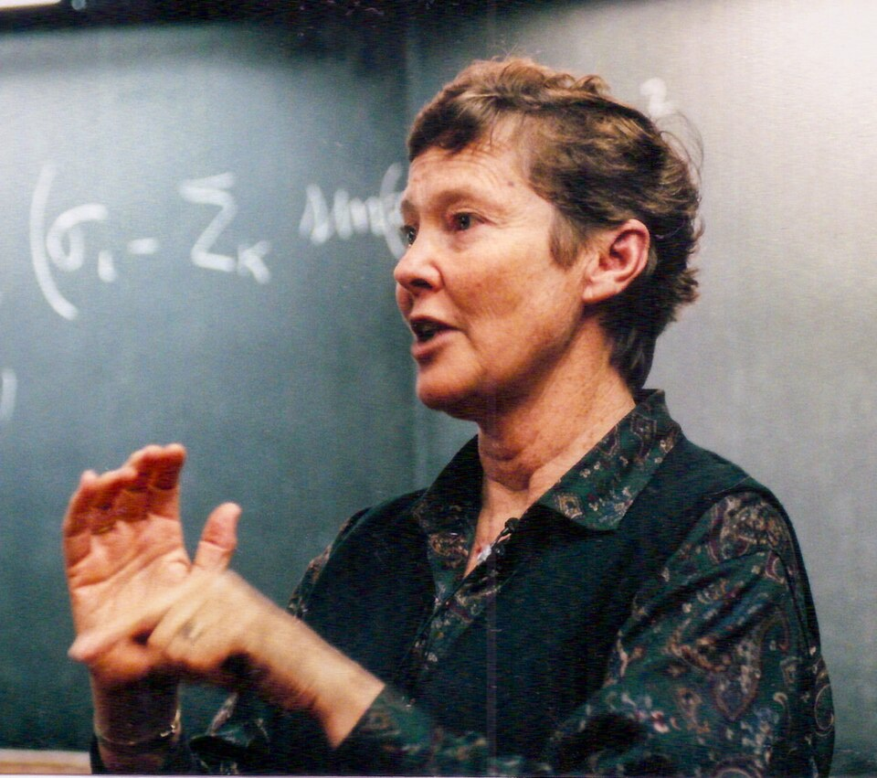

# Helen Quinn

**Born:** 19 May 1943

**Died / status:** Living (as of 2026-10-26)

**Fields:** Particle physics

Sourced photograph or portrait; the image record identifies its creator, provenance, and reuse conditions.

## Biography

An Australian-born theorist who worked at Stanford and SLAC, Quinn investigated the standard model, symmetry breaking, and particle phenomenology. She also became active in science education and curriculum development.

## Major contributions to physics

- Proposed Peccei–Quinn symmetry as a solution to the strong-CP problem.
- Investigated coupling-constant evolution in unified theories with Georgi and Weinberg.
- Studied CP violation and heavy-flavour physics.

## Image source and rights

- Source: [Original image record](https://commons.wikimedia.org/wiki/File:HelenQuinnDiracMedal2000.jpg)
- Creator / attribution: Dan Quinn
- License or rights statement: [CC BY-SA 4.0](https://commons.wikimedia.org/wiki/File:HelenQuinnDiracMedal2000.jpg)
- Local image: [154c7df595345c7617af.jpg](../portraits/154c7df595345c7617af.jpg)
- Credit: Own work

## Sources

- [Helen Quinn — biographical or institutional source (ahro.slac.stanford.edu)](https://ahro.slac.stanford.edu/resources/slac-history/faculty-and-staff-biographies/helen-quinn)
- [Helen Quinn — reference biography (en.wikipedia.org)](https://en.wikipedia.org/wiki/Helen_Quinn)

Record reviewed: 2026-10-26.
