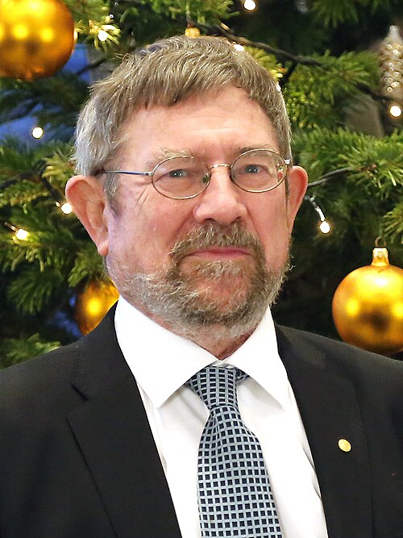

# J. Michael Kosterlitz

**Born:** 22 June 1943

**Died / status:** Living (as of 2026-10-26)

**Fields:** Condensed-matter physics, Statistical physics

For the photographer or artist, date and type of image, consult the original image record.

## Biography

J. Michael Kosterlitz was born in Aberdeen, United Kingdom and conducted research in condensed-matter physics and statistical physics. Nobel records list Brown University as the affiliation at the time of the award. They developed the theory of vortex-pair unbinding in two-dimensional systems with David Thouless. They were awarded the Nobel Prize in Physics in 2016.

## Major contributions to physics

- Developed the theory of vortex-pair unbinding in two-dimensional systems with David Thouless
- Explained a phase-transition mechanism beyond ordinary symmetry breaking

**Nobel Prize in Physics:** 2016

## Image source and rights

- Source: [Original image record](https://commons.wikimedia.org/wiki/File:2016_Nobel_Reception_US_Embassy_Sweden_(31557185216)_(cropped).jpg)
- Creator / attribution: US Embassy Sweden
- License or rights statement: [CC BY 2.0](https://creativecommons.org/licenses/by/2.0)
- Local image: [ea09c4f8d8b870c6af5a.jpg](../portraits/ea09c4f8d8b870c6af5a.jpg)
- Credit: N010

## Sources

- [J. Michael Kosterlitz - Facts](https://www.nobelprize.org/prizes/physics/2016/kosterlitz/facts/)
- [Nobel Prize official laureate API, id 930](https://api.nobelprize.org/2.1/laureate/930)
- [Wikipedia: J. Michael Kosterlitz](https://en.wikipedia.org/wiki/J._Michael_Kosterlitz)

Record reviewed: 2026-10-26.
