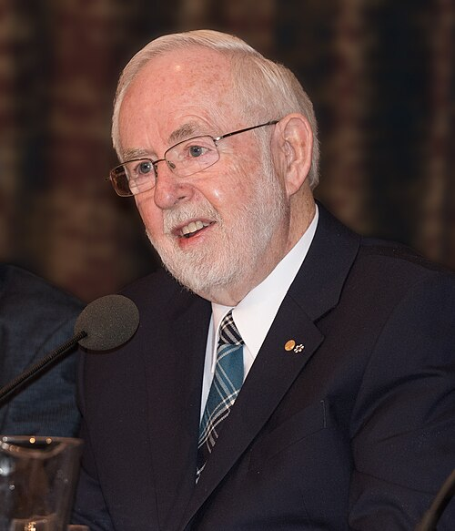

# Arthur B. McDonald

**Born:** 29 August 1943

**Died / status:** Living (as of 2026-10-26)

**Fields:** Particle physics, Neutrinos

For the photographer or artist, date and type of image, consult the original image record.

## Biography

Arthur B. McDonald was born in Sydney, Nova Scotia, Canada and conducted research in particle physics and neutrinos. Nobel records list Queen's University as the affiliation at the time of the award. They led the Sudbury Neutrino Observatory experiment. They were awarded the Nobel Prize in Physics in 2015.

## Major contributions to physics

- Led the Sudbury Neutrino Observatory experiment
- Used different reaction channels to show that solar electron neutrinos transform into other flavours

**Nobel Prize in Physics:** 2015

## Image source and rights

- Source: [Original image record](https://commons.wikimedia.org/wiki/File:Arthur_B._McDonald_5193-2015.jpg)
- Creator / attribution: Bengt Nyman
- License or rights statement: [CC BY-SA 4.0](https://creativecommons.org/licenses/by-sa/4.0)
- Local image: [a0df3a3db273d35d8254.jpg](../portraits/a0df3a3db273d35d8254.jpg)
- Credit: Own work

## Sources

- [Arthur B. McDonald - Facts](https://www.nobelprize.org/prizes/physics/2015/mcdonald/facts/)
- [Nobel Prize official laureate API, id 920](https://api.nobelprize.org/2.1/laureate/920)
- [Wikipedia: Arthur B. McDonald](https://en.wikipedia.org/wiki/Arthur_B._McDonald)

Record reviewed: 2026-10-26.
