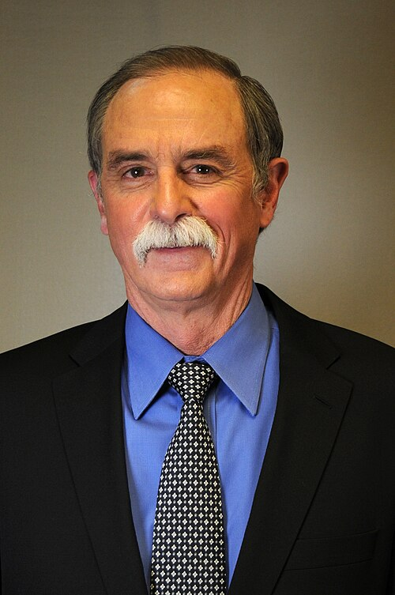

# David J. Wineland

**Born:** 24 February 1944

**Died / status:** Living (as of 2026-10-26)

**Fields:** Atomic physics, Quantum information

For the photographer or artist, date and type of image, consult the original image record.

## Biography

David J. Wineland was born in Milwaukee, WI, USA and conducted research in atomic physics and quantum information. Nobel records list National Institute of Standards and Technology and University of Colorado as the affiliations at the time of the award. They developed laser cooling, trapping and quantum-state control of ions. They were awarded the Nobel Prize in Physics in 2012.

## Major contributions to physics

- Developed laser cooling, trapping and quantum-state control of ions
- Advanced ion-based quantum computing and high-precision atomic clocks

**Nobel Prize in Physics:** 2012

## Image source and rights

- Source: [Original image record](https://commons.wikimedia.org/wiki/File:Portrait_of_David_Wineland.jpg)
- Creator / attribution: Credit Line: Photograph by James Burrus/NIST, courtesy of AIP Emilio Segrè Visual Archives, W. F. Meggers Gallery of Nobel Laureates Collection
- License or rights statement: [CC0](https://commons.wikimedia.org/wiki/File:Portrait_of_David_Wineland.jpg)
- Local image: [5321291ebae4065442d3.jpg](../portraits/5321291ebae4065442d3.jpg)
- Credit: https://repository.aip.org/islandora/object/nbla%3A315040

## Sources

- [David J. Wineland - Facts](https://www.nobelprize.org/prizes/physics/2012/wineland/facts/)
- [Nobel Prize official laureate API, id 877](https://api.nobelprize.org/2.1/laureate/877)
- [Wikipedia: David J. Wineland](https://en.wikipedia.org/wiki/David_J._Wineland)

Record reviewed: 2026-10-26.
