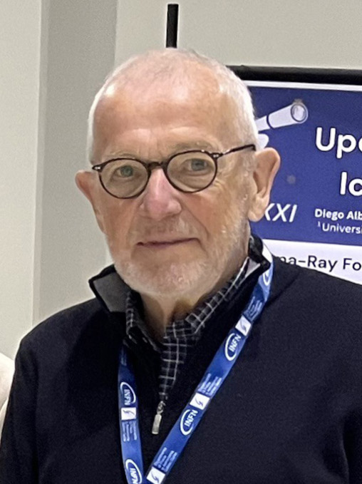

# Francis Halzen

**Born:** 23 March 1944

**Died / status:** Living (as of 2026-10-26)

**Fields:** Particle astrophysics, Neutrino astronomy

For the photographer or artist, date and type of image, consult the original image record.

## Biography

Francis Halzen was born in Tienen, Belgium and conducted research in particle astrophysics and neutrino astronomy. Nobel records list University of Wisconsin–Madison as the affiliation at the time of the award. They helped establish the IceCube Neutrino Observatory. They were awarded the Nobel Prize in Physics in 2026.

## Major contributions to physics

- Helped establish the IceCube Neutrino Observatory
- Made decisive contributions to discovering high-energy neutrinos of astrophysical origin

**Nobel Prize in Physics:** 2026

## Image source and rights

- Source: [Original image record](https://commons.wikimedia.org/wiki/File:Francis_Halzen_(2025).jpg)
- Creator / attribution: infn.it
- License or rights statement: [CC0](http://creativecommons.org/publicdomain/zero/1.0/deed.en)
- Local image: [e290590ef92b4aa57e45.jpg](../portraits/e290590ef92b4aa57e45.jpg)
- Credit: Crop from https://neutrino.pd.infn.it/Neutel2025/Wednesday.html (immediate: https://neutrino.pd.infn.it/Neutel2025/Pictures/Wednesday/IMG_5493.jpg)

## Sources

- [Francis Halzen - Facts](https://www.nobelprize.org/prizes/physics/2026/halzen/facts/)
- [Nobel Prize official laureate API, id 1064](https://api.nobelprize.org/2.1/laureate/1064)
- [Wikipedia: Francis Halzen](https://en.wikipedia.org/wiki/Francis_Halzen)

Record reviewed: 2026-10-26.
