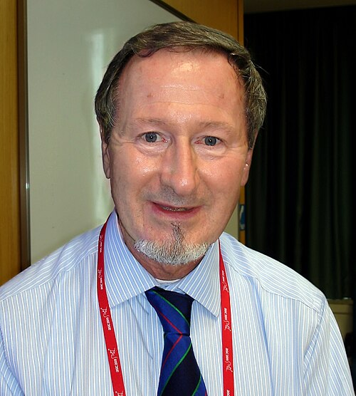

# Douglas D. Osheroff

**Born:** 1 August 1945

**Died / status:** Living (as of 2026-10-26)

**Fields:** Low-temperature physics, Quantum fluids

For the photographer or artist, date and type of image, consult the original image record.

## Biography

Douglas D. Osheroff was born in Aberdeen, WA, USA and conducted research in low-temperature physics and quantum fluids. Nobel records list Stanford University as the affiliation at the time of the award. They discovered superfluidity in helium-3. They were awarded the Nobel Prize in Physics in 1996.

## Major contributions to physics

- Discovered superfluidity in helium-3
- Revealed a new system in which paired fermions form a macroscopic quantum state

**Nobel Prize in Physics:** 1996

## Image source and rights

- Source: [Original image record](https://commons.wikimedia.org/wiki/File:Douglas_Osheroff_2011-08-08_cropped.JPG)
- Creator / attribution: Douglas_Osheroff_2011-08-08.jpg: Finemann derivative work: — Finemann (talk)
- License or rights statement: [CC0](http://creativecommons.org/publicdomain/zero/1.0/deed.en)
- Local image: [bd25e8cce76dcfffa61c.jpg](../portraits/bd25e8cce76dcfffa61c.jpg)
- Credit: Douglas_Osheroff_2011-08-08.jpg

## Sources

- [Douglas D. Osheroff - Facts](https://www.nobelprize.org/prizes/physics/1996/osheroff/facts/)
- [Nobel Prize official laureate API, id 150](https://api.nobelprize.org/2.1/laureate/150)
- [Wikipedia: Douglas Osheroff](https://en.wikipedia.org/wiki/Douglas_Osheroff)

Record reviewed: 2026-10-26.
