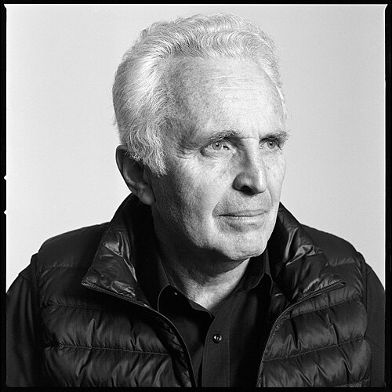

# Alexander Polyakov

**Born:** 27 September 1945

**Died / status:** Living (as of 2026-10-26)

**Fields:** Quantum field theory, Statistical physics

Sourced photograph or portrait; the image record identifies its creator, provenance, and reuse conditions.

## Biography

A Russian-born theorist, Polyakov worked at the Landau Institute before joining Princeton. His nonperturbative methods connect gauge theory, conformal field theory, strings, and critical phenomena.

## Major contributions to physics

- Helped establish the framework of two-dimensional conformal field theory.
- Developed studies of instantons, monopoles, and confinement in gauge theories.
- Introduced the Polyakov action in string quantization.

## Image source and rights

- Source: [Original image record](https://commons.wikimedia.org/wiki/File:Polyakov_1.jpg)
- Creator / attribution: Ne(-ve)rmind47
- License or rights statement: [CC BY-SA 4.0](https://creativecommons.org/licenses/by-sa/4.0)
- Local image: [4a53dd13543b961fb91d.jpg](../portraits/4a53dd13543b961fb91d.jpg)
- Credit: Own work

## Sources

- [Alexander Polyakov — biographical or institutional source (faculty.princeton.edu)](https://faculty.princeton.edu/people/alexander-polyakov)
- [Alexander Polyakov — reference biography (en.wikipedia.org)](https://en.wikipedia.org/wiki/Alexander_Polyakov_%28physicist%29)

Record reviewed: 2026-10-26.
