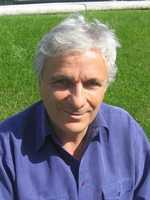

# Michael Green

**Born:** 22 May 1946

**Died / status:** Living (as of 2026-10-26)

**Fields:** String theory, Quantum field theory

Sourced portrait or photograph; see the image record for provenance and reuse conditions.

## Biography

A British theorist at London and Cambridge and a former Lucasian Professor, Green helped develop superstring theory with Schwarz. His research addresses anomalies, scattering amplitudes, and nonperturbative string structure.

## Major contributions to physics

- Established superstring anomaly cancellation with Schwarz.
- Developed superstring amplitudes and quantum-correction calculations.
- Investigated duality and nonperturbative effects.

## Image source and rights

- Source: [Original image record](https://www.damtp.cam.ac.uk/person/mbg15)
- Creator / attribution: See the original image record
- License or rights statement: Copyrighted image; no transferable open licence verified. Permission must be confirmed before website publication.
- Local image: [e4782add18f15d4ab505-b6305846e4.jpg](../portraits/e4782add18f15d4ab505-b6305846e4.jpg)
- Credit: University of Cambridge, DAMTP profile
- Republication: permission for use on a public website has not been verified. Confirm permission with the rightsholder or replace the image before publication.

## Sources

- [Michael Green — reference biography (en.wikipedia.org)](https://en.wikipedia.org/wiki/Michael_Green_%28physicist%29)
- [Michael Green — institutional or scholarly source (www.ictp.it)](https://www.ictp.it/prize/dirac-medal)

Record reviewed: 2026-10-26.
