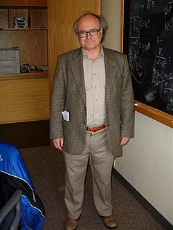

# Gary Gibbons

**Born:** 1 July 1946

**Died / status:** Living (as of 2026-10-26)

**Fields:** Quantum gravity, Mathematical physics

Sourced portrait or photograph; see the image record for provenance and reuse conditions.

## Biography

A British theorist at Cambridge, Gibbons developed Euclidean approaches to gravity with Hawking and others. His work connects the thermodynamics of black-hole and cosmological horizons with geometry and quantum theory.

## Major contributions to physics

- Developed Euclidean quantum-gravity methods with Hawking.
- Investigated gravitational boundary terms and horizon thermodynamics.
- Advanced gravitational-instanton and higher-dimensional-black-hole research.

## Image source and rights

- Source: [Original image record](https://commons.wikimedia.org/wiki/File:GaryGibbons.JPG)
- Creator / attribution: Lumidek at en.wikipedia
- License or rights statement: Public domain
- Local image: [1edc4a0abc60d880aeaf-901c8a429e.jpg](../portraits/1edc4a0abc60d880aeaf-901c8a429e.jpg)
- Credit: Transferred from en.wikipedia to Commons by Ronhjones.

## Sources

- [Gary Gibbons — institutional or scholarly source (www.ictp.it)](https://www.ictp.it/home/dirac-medallists-2025)
- [Gary Gibbons — reference biography (en.wikipedia.org)](https://en.wikipedia.org/wiki/Gary_Gibbons)
- [Gary Gibbons — institutional or scholarly source (www.ictp.it)](https://www.ictp.it/news/2025/8/2025-ictp-dirac-medal-goes-gravity-explorers)
- [Gary Gibbons — institutional or scholarly source (damtp.cam.ac.uk)](http://damtp.cam.ac.uk/people/g.w.gibbons)
- [Gary Gibbons — institutional or scholarly source (www.ictp.it)](https://www.ictp.it/prize/dirac-medal)

Record reviewed: 2026-10-26.
