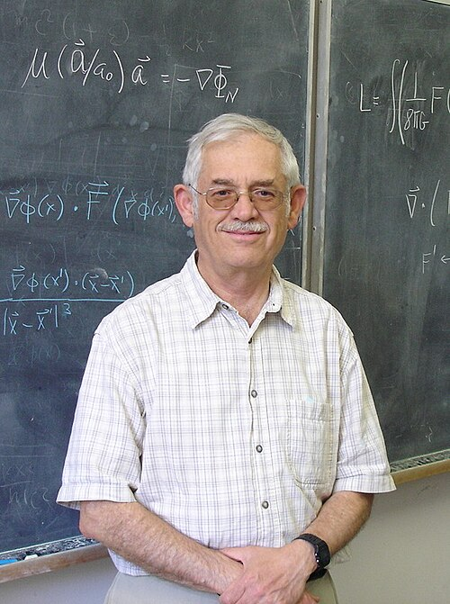

# Jacob Bekenstein

**Born:** 1 May 1947

**Died / status:** 16 August 2015

**Fields:** Black-hole physics, Gravitation

Sourced photograph or portrait; the image record identifies its creator, provenance, and reuse conditions.

## Biography

Born in Mexico, Bekenstein studied with Wheeler at Princeton before teaching in Israel. His early proposal that black holes possess entropy helped establish links between thermodynamics, information, and gravitation.

## Major contributions to physics

- Proposed black-hole entropy proportional to horizon area.
- Formulated the generalized second law including black-hole entropy.
- Established the Bekenstein bound on entropy and information in finite systems.

## Image source and rights

- Source: [Original image record](https://commons.wikimedia.org/wiki/File:Bekenstein100_(cropped).JPG)
- Creator / attribution: Bekenstein
- License or rights statement: Public domain
- Local image: [59778a347532adade592.jpg](../portraits/59778a347532adade592.jpg)
- Credit: Own work

## Sources

- [Jacob Bekenstein — reference biography (en.wikipedia.org)](https://en.wikipedia.org/wiki/Jacob_Bekenstein)

Record reviewed: 2026-10-26.
