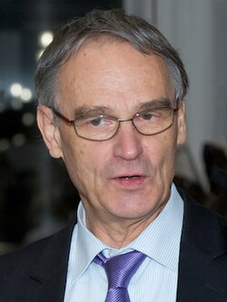

# Gerd Binnig

**Born:** 20 July 1947

**Died / status:** Living (as of 2026-10-26)

**Fields:** Surface physics, Scanning probes

For the photographer or artist, date and type of image, consult the original image record.

## Biography

Gerd Binnig was born in Frankfurt-on-the-Main, West Germany (now Germany) and conducted research in surface physics and scanning probes. Nobel records list IBM Zurich Research Laboratory as the affiliation at the time of the award. They invented the scanning tunnelling microscope with Heinrich Rohrer. They were awarded the Nobel Prize in Physics in 1986.

## Major contributions to physics

- Invented the scanning tunnelling microscope with Heinrich Rohrer
- Used tunnelling current to investigate conductive surfaces at atomic scales

**Nobel Prize in Physics:** 1986

## Image source and rights

- Source: [Original image record](https://commons.wikimedia.org/wiki/File:Gerd_Binnig_at_the_Memorial_Symposium_for_Heinrich_Rohrer_(cropped)_2.jpg)
- Creator / attribution: ibm research zurich
- License or rights statement: [CC BY 2.0](https://creativecommons.org/licenses/by/2.0)
- Local image: [feae1b627a7926a6f9e8.jpg](../portraits/feae1b627a7926a6f9e8.jpg)
- Credit: https://www.flickr.com/photos/ibm_research_zurich/11432794546

## Sources

- [Gerd Binnig - Facts](https://www.nobelprize.org/prizes/physics/1986/binnig/facts/)
- [Nobel Prize official laureate API, id 128](https://api.nobelprize.org/2.1/laureate/128)
- [Wikipedia: Gerd Binnig](https://en.wikipedia.org/wiki/Gerd_Binnig)

Record reviewed: 2026-10-26.
